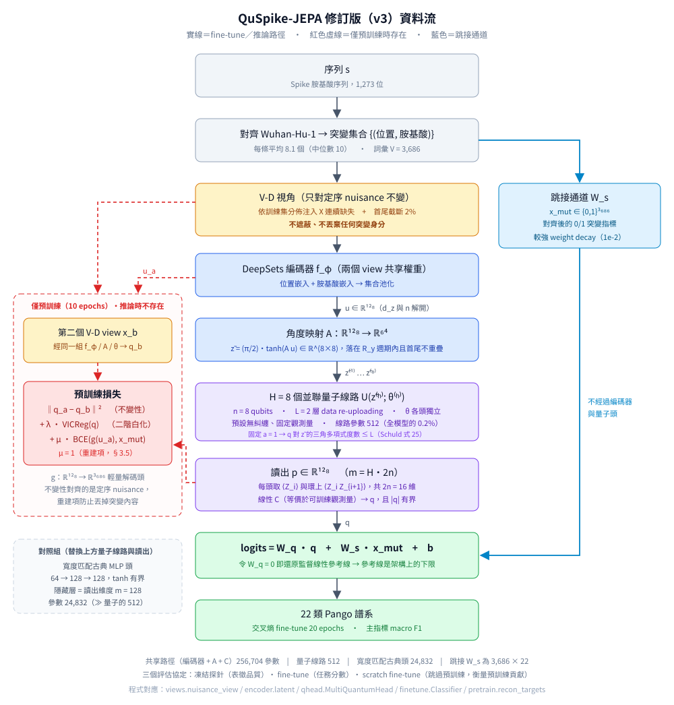

# 量子歸納偏置與 JEPA 預訓練在 SARS-CoV-2 Spike 譜系分類上的對照研究

**負面結果報告（QuSpike-JEPA，v1–v3）**

- 版本：2026-11-15
- 程式：`Research/QuSpike_JEPA/`；設計文件：[QuSpike-JEPA.md](QuSpike-JEPA.md)
- 原始結果：`Results/quspike_jepa/`（v1）、`Results/quspike_jepa_v2/`（v2）、`Results/quspike_jepa_v3/report.md`（v3）
- 資料：`Data/spike-lineage/dataset_v2.tsv`

---

## 摘要

我們在 22 類 Pango 譜系分類（只用 Spike 胺基酸序列）上，檢驗兩個主張：(i) JEPA 式自監督預訓練能學到有用的序列表徵；(ii) 變分量子線路作為投影頭，其歸納偏置（有界、週期、低頻）在此任務上有幫助。經過三輪實驗、並在第三輪建立有效對照組後，**兩個主張都被否證**。

在同讀出寬度（m=128）、同通道、同視角、同 fine-tune 協定、3 種子下：

- **預訓練的貢獻為負**：fine-tune 減 scratch fine-tune = −0.015（量子）／−0.012（寬度匹配古典），落在雜訊內；只用量子通道時 −0.045，超過雜訊下限，是可檢出的傷害。
- **量子頭沒有優於古典頭**：量子 − 寬度匹配古典 = −0.007（不預訓練）／−0.010（預訓練），皆在雜訊內，而計算時間為 6–7 倍。
- **沒有任何設定超過最簡單的基準**：「對齊後突變指標 + 監督線性分類」達 test macro F1 **0.747**（1 秒），最好的量子設定 0.733、最好的古典 JEPA 設定 0.740。
- **一個額外發現（本輪新增）**：在凍結探針下，JEPA 預訓練的表徵**比隨機初始化更差**（test macro F1 0.506 vs 0.641），而其有效秩高出 8 倍（114.7 vs 14.0）。這同時否證預訓練的表徵價值，與「有效秩可作為表徵品質指標」的常見做法。

我們同時報告一個對先前判斷的修正：標籤歧義「天花板」0.930 是以偷看標籤的簽章 oracle 估出的**鬆上界**（57% 的測試序列擁有獨一無二的突變簽章，等於被背下來）。若改用不偷看測試標籤的精確簽章查表，只有 42% 的測試序列能命中訓練集中見過的簽章，macro F1 僅 0.411。因此「0.747 → 0.93 還有 0.18 的空間」是**上界的差距，不是可實現的空間**，真實可達值很可能遠低於 0.93。

本工作的貢獻因此不是方法，而是：一組有效的對照組設計、三個被實測證實的方法學陷阱，以及一個事前訂好判準、可被引用的否證結果。

---

## 1. 研究問題

Pango 譜系是由突變集合定義的。這使「Spike 序列 → 譜系」成為一個表面上像分類、實質上與標籤定義幾乎同源的任務。我們想知道：在這樣一個任務上，

1. JEPA（Joint-Embedding Predictive Architecture，Balestriero & LeCun）的「對 view 不變 + 二階白化」目標，能否學到比監督式訓練自己學到的更好的表徵？
2. 把 JEPA 的投影頭換成變分量子線路（data re-uploading，Schuld 的部分傅立葉級數觀點），其有界、週期、低頻的歸納偏置是否帶來增益？

這兩個問題必須在**同一個強基準之上**回答，否則任何正分數都可能只是重現了基準。本報告的主要方法學立場即在此。

### 1.1 為何不沿用 QuStyleGAN 的編碼與指標

先行工作（Jin et al., arXiv:2203.03556）把長度 1024 的 0/1 突變向量 `v` 做 L2 正規化後取 `ρ = |v⟩⟨v|`（純態）。此時其保真度公式的第二項 `√((1−Trρ²)(1−Trσ²))` 恆為 0，保真度退化為 `(v·w)²/(‖v‖²‖w‖²)`，即餘弦相似度的平方。Delta 相對參考序列在 Spike 上僅約 11 個突變（本資料實測中位數），兩條序列只要共享少數熱點（D614G、P681R 等）就有高重疊；而「與歷史序列相似」本身就是被訓練的目標，且該工作沒有時間切分。因此其 94–96% 的保真度不能支持「預測未來突變」的能力。

本研究因此一律使用分類指標 + 時間切分，並強制與簡單基準並列報告。

---

## 2. 任務與資料

### 2.1 資料集

`Data/spike-lineage/dataset_v2.tsv`，由 NCBI Virus（NCBI Datasets CLI）下載的人類宿主、完整 Spike 蛋白序列建成（`Data/spike-lineage/build_dataset.py`）。

| 項目 | 值 |
|---|---|
| 譜系（類別）數 | 22 |
| 序列數 | 31,689（train 22,175 / test 9,514） |
| 每譜系上限 | 3,000（固定種子抽樣） |
| 品質過濾 | 只允許 20 種標準胺基酸與 `X`；`X` ≤ 5%；長度 1200–1300 |
| 去重 | 以完整序列去重，保留最早日期；同序列跨譜系衝突者整條刪除 |
| 切分 | **每譜系內按採集日期排序，前 70% 為 train、後 30% 為 test**（無日期者歸 train） |
| validation | train 內每譜系日期最晚的 15%（`dataset.split_validation`） |
| 突變詞彙 V | 3,686 個 (位置, 胺基酸) token（相對 Wuhan-Hu-1，排除 `X`） |

切分是**譜系內的時間切分**，不是隨機切分：測試集是每個譜系較晚採集的序列，因此包含訓練期未見過的突變組合。

### 2.2 資料的關鍵結構

每條序列的突變數（相對 Wuhan-Hu-1，排除 `X`）：平均 8.1、中位數 10、10–90 百分位 2–12、最大 138。按譜系：

| 譜系 | 平均突變數 | | 譜系 | 平均突變數 |
|---|---|---|---|---|
| C.37 | 14.8 | | B.1.617.1 | 7.3 |
| P.1 | 12.8 | | B.1.526 | 6.9 |
| AY.4 / AY.2 | 11.9 / 12.9 | | B.1.427 / B.1.429 / R.1 | 5.0 / 4.9 / 5.0 |
| AY.25 / AY.3 | 11.4 / 11.4 | | B.1.1.519 | 4.9 |
| B.1.1.7 | 11.2 | | **B.1.177** | **2.9** |
| B.1.617.2 | 11.0 | | **B.1.2** | **2.3** |
| AY.103 / AY.44 | 10.9 / 10.9 | | **B.1.1** | **2.2** |
| B.1.351 | 10.6 | | **B.1** | **1.9** |

**B.1 系（B.1、B.1.1、B.1.2、B.1.177）在 Spike 上平均只有 2–3 個突變**。這四個類別之間幾乎沒有 Spike 層級的判別訊號——它們主要由 Spike 以外的突變定義。這個事實預先決定了本任務的難度上限，與模型無關（見 §6.5、§7.1）。

此外 54.3% 的序列含 `X`（定序缺失），每條平均 9.1 個、最多 63 個，常以連續段出現（amplicon dropout）。這是一個真實存在、且與標籤無關的 nuisance，我們以此設計 V-D 視角（§3.5）。

### 2.3 與文獻基準的關係

Murad et al.（arXiv:2501.14746）在 Spike7k（GISAID）上以 70/30 × 5-fold **隨機**切分報告 Acc 0.810 / F1-weighted 0.782 / **F1-macro 0.426**。本研究的資料來源（NCBI）、類別組成與切分方式（時間切分）都不同，**不可直接並列**。作為參考，我們的基準線在本資料上為 Acc 0.686 / F1-weighted 0.683 / **F1-macro 0.747** / ROC-AUC(OvR) 0.974：macro F1 高得多而 accuracy 較低，原因是大類（AY.*、B.1.2，各 900 條）難、小類（C.37、B.1.617.1）易，而 macro 平均不加權。

本報告一律以 **F1-macro** 為主指標（類別極不平衡，最大類 900 條、最小類 14 條）。

---

## 3. 方法

### 3.1 架構總覽



主幹為 fine-tune／推論路徑；左側紅色虛線框只在預訓練時存在，右側藍色為跳接通道。分類層為

```
logits = W_q · q  +  W_s · x_mut  +  b
```

令 `W_q = 0` 即還原監督線性參考線，因此參考線是**架構上的下限**（§3.4）。

### 3.2 編碼器與容量解開

原設計令潛向量維度 `k = n_qubits`（6–10），使編碼器必須把 3,686 維的突變指標壓成 6 維才進量子頭。v1 的診斷顯示這是主要瓶頸（§6.7）。修訂後：

- 編碼器輸出寬潛向量 `u ∈ ℝ^{d_z}`，`d_z = 128`，與 n 無關；
- 線性角度映射 `A: ℝ^{d_z} → ℝ^{H·n}`，逐角度縮放 `z̃ = (π/2)·tanh(A u)`。

縮放用 `(π/2)·tanh` 而非 `π·tanh`：`R_y(π)` 與 `R_y(−π)` 只差全域相位、可觀測量完全相同，用 π 會把編碼器飽和後的兩個極端映成同一點。

### 3.3 並聯量子頭

依 v1 消融（§6.6）把預算從深度移到寬度：**n=8、L=2、H=8**，讀出 `m = H·2n = 128`。

```
|0⟩^n ─ W¹ ─ S₁(z̃) ─ W² ─ S₂(z̃) ─ W³ ─ 量測
S_l(z̃) = ⊗_i R_y(a_{l,i}·z̃_i + b_{l,i})        （data re-uploading）
W^l     = ⊗_i [R_z(α)·R_y(β)]（預設不加糾纏閘）
```

- 讀出：`⟨Z_i⟩`（n 個）+ 環上相鄰 `⟨Z_iZ_{i+1}⟩`（n 個），每個頭 2n = 16 維，concat 後 128 維，再經線性 `C`（等價於可訓練觀測量，Schuld 結論 5）。
- 固定 `a = 1`，故 `q` 的每個分量是 `z̃` 的三角多項式、度數 ≤ L（Schuld 式 25），有單元測試檢驗。
- H 個頭的 θ 獨立；H 個 2^8=256 維狀態向量一次批次模擬（torch 複數張量 + autograd）。
- **糾纏與可訓練觀測量預設關閉**（依 v1 消融，開啟沒有可檢出的貢獻）。
- 線路參數：`H·(3nL+2n) = 8·64 = 512`。

### 3.4 跳接：讓基準線成為結構下限

因為「突變指標 + 監督線性」已達 0.747，而 JEPA 設定都在它之下，我們把這條基準線直接接入分類層（`W_s`）。這使**基準線成為架構上的下限**（令 `W_q = 0` 即可還原），量子路徑只需提供「基準線之外的增量」。判準隨之從絕對分數改為增量。

這個設計的意義：若模型仍追不上基準線，就不能歸因於優化難度或初始化——下限在結構裡。對 `W_s` 施加較強的 weight decay（1e-2，對比其餘 1e-4），並加跑只有 `W_q`、只有 `W_s` 的單通道消融以確認增量來源。

### 3.5 目標函數與視角

```
L = E‖q_a − q_b‖²  +  λ·VICReg(q)  +  μ·BCE(g(u_a), x_mut)
```

- **不變性 + 二階白化**：`q ∈ [−1,1]^m` 有界，與要求高斯邊際的 SIGReg 不相容，故採 VICReg 式的變異數下限 + 非對角共變異數懲罰（`loss.whitening_penalty`）。v1 證實這一項必要（vicreg 0.321±0.061 vs none 0.114±0.044）。
- **重建項（μ=1）**：`g: ℝ^{d_z} → ℝ^{V}` 的輕量解碼頭，只在預訓練時存在。加入動機是 v1 的消融一致指向「不變性目標正在移除標籤訊號」（§6.6），重建項用來阻止表徵把突變內容一起丟掉。
- **視角 V-D（定序 nuisance）**：正樣本是同一條序列的兩次「定序層級」破壞——依訓練集實際的 `X` 連續段長度分佈注入缺失、並隨機截斷首尾 2%——而**不遮蔽、不丟棄任何突變的身分**。這是對 Balestriero good/bad view 框架的一個修正：此處「好視角」的判準不是「是否同一世界狀態」，而是「不變性是否落在與標籤正交的方向上」。

### 3.6 三個評估協定

v1 只用凍結探針，導致「預訓練有用」的錯誤印象。修訂後一律三者並列：

1. **凍結探針**：凍結編碼器 + 線性探針。衡量表徵品質，**不是任務分數**。
2. **fine-tune**：編碼器 + 量子頭 + 分類層整體以交叉熵訓練。**這才是任務分數。**
3. **scratch fine-tune**：同架構、同 fine-tune，但跳過預訓練（`--epochs 0`）。

**(2) − (1) 衡量表徵品質，(2) − (3) 才是預訓練的真實貢獻。** 任何「預訓練有用」的說法都必須附上 (3)。

---

## 4. 實驗設定

| 項目 | 設定 |
|---|---|
| 預訓練 | 10 epochs，lr 2e-3，batch 256，梯度裁剪 1.0 |
| fine-tune | 20 epochs，lr 1e-3，head lr 1e-2，wd 1e-4，`W_s` wd 1e-2 |
| 種子 | 3（0/1/2），報告平均 ± 樣本標準差 |
| 雜訊下限 | **0.02**。v1 實測同設定同種子在 GPU 上重跑的 val macro F1 可差到 0.06（`quantum_n6L3` seed 0：0.562/0.605/0.614/0.621），故單種子差異不可解讀 |
| 判定規則 | 增量須同時超過 0.02 與兩組的種子標準差，才算有增量（`summary.verdict`） |
| 硬體 | RTX 5060 Laptop GPU (8GB)，PyTorch 狀態向量模擬 |

**參數量**（全模型，含編碼器）：

| 設定 | 共享路徑 | 頭 | 跳接等其他 | 合計 |
|---|---|---|---|---|
| 量子（H=8, n=8, L=2） | 256,704 | **512** | — | 257,216 |
| 寬度匹配古典（隱藏層 = m = 128） | 256,704 | **24,832** | — | 281,536 |
| 基準線（只有 `W_s`） | — | — | — | 249,546 |
| 上述 + 預訓練（含重建頭 g） | | | +434,343 | 691,559 / 715,879 |

注意：量子線路只佔全模型的 **0.2%**，寬度匹配古典頭佔 8.8%。任何「頭」的比較都只是在比模型的極小部分，必須如此陳述。

**對照組清單**（這是 v3 相對 v1/v2 的主要修正）：

1. 監督線性基準線（做成結構下限，§3.4）；
2. **寬度匹配**古典 MLP 頭（隱藏層 = 讀出維度 m = 128，`qhead.WideClassicalHead`）——取代 v1 的「參數量匹配」頭；
3. scratch fine-tune（§3.6 協定 3）；
4. 單通道消融（只有 `W_q` / 只有 `W_s`）；
5. 標籤歧義上界（簽章 oracle，§6.5）。

**表徵塌陷判準**：有效秩 < 2、或**標準差低於 1e-3 的維度比例 > 0.5**（`loss.dead_dim_frac`）、或凍結探針未超過多數類基準的 1.5 倍。原訂的「任一維度標準差低於閾值即塌陷」在 m=128 的並聯讀出下會誤報（實測最小維度標準差 2.2×10⁻⁶ 的執行仍有正常表現），已修正。塌陷是**預訓練表徵**的診斷，fine-tune 會重訓編碼器，故不據此排除 fine-tune 的任務分數。

---

## 5. 主結果

### 5.1 任務分數（test macro F1，22 類，3 種子）

| 設定 | 通道 | 預訓練 | macro F1 | Acc | F1-w | AUC | 距基準線 | 秒 |
|---|---|---|---|---|---|---|---|---|
| **監督線性基準線** | skip | — | **0.747±0.000** | 0.686 | 0.683 | 0.974 | — | **1** |
| 寬度匹配古典 | both | 無 | 0.740±0.005 | 0.690 | 0.683 | 0.973 | −0.007 | 19 |
| **量子 H8（最佳量子設定）** | both | 無 | **0.733±0.009** | 0.687 | 0.680 | 0.973 | −0.014 | 141 |
| 寬度匹配古典 | both | 有（μ=1） | 0.728±0.006 | 0.678 | 0.672 | 0.973 | −0.019 | 48 |
| 量子 H8 | 只有 q | 無 | 0.722±0.004 | 0.673 | 0.668 | 0.970 | −0.025 | 140 |
| 量子 H8 | both | 有（μ=1） | 0.718±0.007 | 0.672 | 0.666 | 0.971 | −0.029 | 290 |
| 量子 H8 | 只有 q | 有（μ=1） | 0.677±0.008 | 0.644 | 0.638 | 0.965 | −0.070 | 346 |

基準線的種子標準差為 0.000（三顆種子分別 0.747208 / 0.747052 / 0.746572）：它只訓練一個線性層，幾乎不受初始化影響。

### 5.2 增量判定

| 假說 | 比較 | A | B | A − B | 判定 |
|---|---|---|---|---|---|
| H4′ 預訓練貢獻 | 量子，both | 0.718±0.007 | 0.733±0.009 | **−0.015** | 雜訊內 |
| H4′ 預訓練貢獻 | 古典，both | 0.728±0.006 | 0.740±0.005 | **−0.012** | 雜訊內 |
| H4′ 預訓練貢獻 | 量子，只有 q | 0.677±0.008 | 0.722±0.004 | **−0.045** | **較差（可檢出）** |
| H3′ 跳接增量 | 量子 − 基準線 | 0.733±0.009 | 0.747±0.000 | **−0.014** | 雜訊內 |
| H3′ 跳接增量 | 古典 − 基準線 | 0.740±0.005 | 0.747±0.000 | **−0.007** | 雜訊內 |
| **量子 vs 古典** | both，不預訓練 | 0.733±0.009 | 0.740±0.005 | **−0.007** | 雜訊內 |
| **量子 vs 古典** | both，預訓練 | 0.718±0.007 | 0.728±0.006 | **−0.010** | 雜訊內 |

兩個修訂後的假說（H3′ 跳接增量、H4′ 預訓練貢獻）都未超過事前訂下的 +0.02 門檻，且符號皆為負。量子對古典的兩個比較也都是負值。

### 5.3 凍結探針：預訓練比隨機初始化更差

這是本輪最強的單一結果，且方向與 v2 相反。

| 編碼器狀態 | 頭 | 讀出維度 | 凍結探針 test macro F1 | 有效秩 |
|---|---|---|---|---|
| 隨機初始化 | 量子 H8 | 128 | **0.641±0.006** | 14.0 |
| 隨機初始化 | 寬度匹配古典 | 128 | **0.635±0.006** | 17.5 |
| JEPA 預訓練（10 ep, μ=1, V-D） | 量子 H8 | 128 | **0.506±0.014** | 114.7 |
| JEPA 預訓練（10 ep, μ=1, V-D） | 寬度匹配古典 | 128 | **0.509±0.006** | 96.7 |
| 隨機初始化 | 古典（單頭） | 16 | 0.080±0.009 | 1.4 |

三點結論：

1. **JEPA 預訓練使表徵的線性可解碼性下降 0.135**（0.641 → 0.506），遠超雜訊下限。加入 V-D 視角與重建項之後仍然如此。預訓練不只是「沒幫助」，而是**比什麼都不做更差**。
2. **有效秩與表徵品質反向**：預訓練把有效秩從 14 推到 115（8 倍），探針分數反而掉 0.135。有效秩用正規化奇異值、與尺度無關，它衡量「用了幾個維度」，不衡量「用得對不對」。**有效秩不可作為表徵品質或塌陷的單一判準。**
3. **容量是 v1 的真正瓶頸**：同樣是隨機初始化、同樣沒有任何訓練，16 維讀出只有 0.080，128 維讀出有 0.641。單純把讀出從 12–16 維放寬到 128 維，就為凍結探針帶來約 +0.56——這是整個研究中最大的單一效應，而它與 JEPA 和量子都無關。

### 5.4 成本

| 設定 | 秒 | 相對基準線 |
|---|---|---|
| 監督線性基準線 | 1 | 1× |
| 寬度匹配古典，不預訓練 | 19 | 19× |
| 寬度匹配古典，預訓練 | 48 | 48× |
| 量子，不預訓練 | 141 | 141× |
| 量子，預訓練 | 290 | 290× |

分數由高到低的順序，與成本由低到高的順序**完全相同**。

### 5.5 逐類別與分群

最佳量子設定（0.733）與基準線（0.747）的逐類別 test F1（按基準線升冪）：

| 譜系 | n | 基準線 | 量子最佳 | | 譜系 | n | 基準線 | 量子最佳 |
|---|---|---|---|---|---|---|---|---|
| B.1.1 | 180 | 0.296 | 0.300 | | B.1.429 | 669 | 0.869 | 0.865 |
| AY.44 | 900 | 0.449 | 0.464 | | R.1 | 79 | 0.956 | 0.875 |
| B.1 | 673 | 0.468 | 0.347 | | B.1.351 | 86 | 0.958 | 0.964 |
| AY.4 | 201 | 0.478 | 0.519 | | B.1.526 | 678 | 0.963 | 0.952 |
| AY.103 | 900 | 0.484 | 0.490 | | AY.2 | 14 | 0.966 | 0.946 |
| B.1.617.2 | 717 | 0.499 | 0.526 | | B.1.1.7 | 900 | 0.968 | 0.967 |
| AY.3 | 676 | 0.547 | 0.537 | | P.1 | 343 | 0.983 | 0.971 |
| B.1.427 | 330 | 0.651 | 0.647 | | B.1.1.519 | 299 | 0.985 | 0.971 |
| B.1.2 | 900 | 0.679 | 0.744 | | B.1.617.1 | 14 | 1.000 | 0.901 |
| B.1.177 | 48 | 0.724 | 0.662 | | C.37 | 36 | 1.000 | 0.995 |
| AY.25 | 683 | 0.736 | 0.722 | | | | | |

損失完全集中在兩群：**B.1 系**（B.1.1 0.296、B.1 0.468、B.1.2 0.679、B.1.177 0.724）與 **Delta 母／子譜系**（B.1.617.2 0.499、AY.44 0.449、AY.4 0.478、AY.103 0.484、AY.3 0.547）。其餘 11 類多在 0.87–1.00。

按群分解（最佳觀測值 vs 簽章 oracle 上界）：

| 群 | 類別數 | 最佳觀測 | oracle 上界 | 差距 |
|---|---|---|---|---|
| b1_family（B.1／B.1.1／B.1.2／B.1.177） | 4 | 0.542 | 0.921 | −0.379 |
| delta_parent（B.1.617.2） | 1 | 0.527 | 0.836 | −0.309 |
| delta_sub（AY.*） | 6 | 0.616 | 0.876 | −0.260 |
| others | 11 | 0.918 | 0.971 | −0.053 |

---

## 6. 歷史：v1 與 v2，以及 v1 結論為何無效

### 6.1 v1（11 類，凍結探針，V-A 視角）

v1 誤用了 11 類的 `dataset.tsv`。其主表（11 類，test macro F1）：

| 設定 | 種子 | macro F1 |
|---|---|---|
| 突變指標 + 監督線性 | — | **0.843** |
| 005：dt／onehot（未對齊，見下） | 5 | 0.833±0.002 |
| **凍結 ESM-2 t30 150M，平均池化 + 線性 probe** | 3 | **0.808±0.000** |
| 凍結 ESM-2 t30 150M，site 特徵 | 1 | 0.810±0.000 |
| 最近鄰（突變集合，`mutset_nn`） | 1 | 0.758±0.000 |
| 005：dt／ae_embedding | 5 | 0.707±0.009 |
| 量子 n=6, L=3 | 3 | 0.682±0.026 |
| 量子 n=6, L=3（L=1 變體） | 3 | 0.667±0.011 |
| 古典（參數量匹配） | 3 | 0.364±0.082 |
| 古典（同實作，未匹配） | 3 | 0.368±0.088 |
| 隨機編碼器 | 2 | 0.229±0.019 |

**凍結的預訓練蛋白質語言模型（ESM-2 150M）在 11 類上得 0.808（val 0.815），仍低於突變指標 + 線性的 0.843。** ESM-2 的三顆種子分數完全相同（標準差 0.000）：特徵是凍結的，只有 probe 在訓練。

**22 類的補測（2026-11-15，3 種子完成）**：同一組凍結嵌入在 22 類上得 **test 0.6786 ± 0.0000 / val 0.7310**（accuracy 0.6445、F1-weighted 0.6363、ROC-AUC 0.9636），低於參考線 0.747 達 **−0.068**。三顆種子完全相同，因為特徵是凍結的、只有探針在訓練。

| 類別數 | 凍結 ESM-2（test） | 突變指標 + 線性（test） | 差距 |
|---|---|---|---|
| 11 | 0.808 | 0.843 | −0.035 |
| **22** | **0.679** | **0.747** | **−0.068** |

**失敗的類別完全相同。** ESM-2 最差的六類是 B.1.1 0.191、B.1.617.2 0.394、AY.44 0.395、B.1 0.396、AY.3 0.433、AY.103 0.437——與突變指標模型（§5.5）以及群天花板（§1.3(v)）指向的**同一批類別**。兩種性質完全不同的表徵（3,686 維二元指標 vs 640 維語言模型嵌入）在同樣的地方失敗，這強烈指向瓶頸在輸入資訊本身，而不在表徵方式。

**類別數增加後差距擴大。** 這條補測原本是用來檢驗 §7.2「0.747 已相當接近只用 Spike 所能達到的程度」是否站得住——結果是站得住，而且比原先的論據更強：一個 150M 參數、在大規模蛋白質序列上預訓練的語言模型，在這個任務上仍明顯不及 3,686 維二元突變指標加一個線性層（1 秒可訓完）。這與 §7.1 的第一個機制一致：譜系由突變集合定義，而突變指標就是該定義的向量化，序列的其餘資訊對這個標籤幾乎不帶增量。

注意 005 的 onehot 基準（0.833）沒有先對齊參考序列，Delta 的 156–158 刪除會讓後續位置錯開，因此它低估了對齊後的線性基準線。

**「量子 0.682 vs 古典 0.364」曾是本研究看起來最強的結果，它是對照組缺陷造成的假象。** 原因有兩層：

1. 量子線路 66 個參數、古典頭 69 個，但**編碼器有 104,134 個參數，頭只佔全模型 0.06%**，兩組的編碼器完全相同——比較的是模型的 0.06%；
2. 要把古典頭匹配到 66 個參數，其隱藏層只剩 **3 個單元**。那是一個瓶頸，不是對照組。

v3 用寬度匹配（隱藏層 = 讀出維度）重做這個對照，差距縮為 −0.007（§5.2）。

### 6.2 v2（22 類，加入 fine-tune 協定，seed 0）

| 設定 | 凍結探針（val） | fine-tune（val） | fine-tune（test） |
|---|---|---|---|
| 量子，有預訓練 | 0.511 | 0.727 | 0.696 |
| 量子，不預訓練 | 0.281 | 0.728 | **0.709** |
| 古典，有預訓練 | 0.197 | 0.706 | 0.681 |
| 古典，不預訓練 | 0.159 | 0.688 | 0.666 |

v2 的教訓：預訓練確實讓**凍結探針**變好（0.281 → 0.511），但 fine-tune 之後差異消失甚至反轉。**只報告凍結探針會得到相反的結論。** 這是 §3.6 三協定的由來。

v3 進一步顯示，v2 看到的「預訓練改善探針」本身是容量瓶頸的產物：當讀出放寬到 128 維之後，隨機初始化的探針已達 0.641，而預訓練把它降到 0.506（§5.3）。

### 6.3 v1 消融（11 類，val macro F1，3 種子）

| 軸 | 取值與分數 | 是否超過種子標準差 |
|---|---|---|
| `n_qubits`（寬度） | 4: 0.564±0.005、6: 0.650±0.040、8: 0.677±0.006、10: 0.686±0.003 | **是**（4→6、8→10） |
| `n_layers`（深度） | 1: 0.586±0.068、2: 0.674±0.016、3: 0.662±0.039、4: 0.676±0.009 | 1→2 是，之後否（飽和） |
| `entangle` | False: 0.666±0.088；預設 True: 0.641±0.068 | 否（**無可檢出貢獻**） |
| `trainable_obs` | False: 0.684±0.004；預設 True: 0.641±0.068 | 否（**無可檢出貢獻**） |
| `mask_ratio` | 0.05: 0.430±0.043、0.15: 0.322±0.060、0.3: 0.371±0.069、0.5: 0.350±0.048 | 0.05 vs 0.15 是 |
| `min_mutations` | 1: 0.410±0.057、3: 0.322±0.059、6: 0.307±0.076 | 1 vs 3 是 |
| `mask_level` | position 0.383、mutation 0.321、both 0.321、span 0.286 | span 是 |
| `variant`（視角） | self_distort 0.382±0.010、neighbor 0.340±0.072、same_lineage 0.321±0.060 | self_distort 是 |
| `whitening` | vicreg 0.321±0.061、identity 0.123±0.041、none 0.114±0.044 | **是** |
| `mask_dist` | variability 0.359±0.104、uniform 0.321±0.061 | 否 |
| `shots/noise`（1024 shots, p=0.02） | 0.654±0.037，預設 0.641±0.068 | 否 |

兩個方向清楚、且超過雜訊的結論：

1. **「破壞越少越好」。** 遮蔽比例、最小突變數、遮蔽層級三條軸都指向同一方向，而最好的視角恰是原本被設為對照的 bad view（self_distort）。解釋：譜系由少數專屬突變定義，而不變性項的作用正是讓表徵對那些突變的有無不敏感——**不變性目標正在移除標籤訊號本身**。這直接推翻了 H1（good view 優於 bad view），並導致 V-D 的設計（§3.5）。
2. **收益只來自寬度。** `n_qubits` 單調上升且超過標準差；深度在 L=2 飽和；糾纏與可訓練觀測量關閉後不比開啟差。因此這個線路實際扮演的是**有界、週期性的隨機特徵展開**，不是在利用糾纏或高次傅立葉分量。這導致把預算從 L 移到 H（並聯頭）的修訂（§3.3）。

注意 v1 消融的種子標準差普遍在 ±0.04–0.10，上表中多數比較落在雜訊內；只有標為「是」的那幾項可以解讀。有限 shots（1024）+ 去極化噪聲（p=0.02）沒有造成可檢出的掉點，但這是在一個本來就不依賴量子結構的線路上測的，不能作為硬體可行性的正面證據。

### 6.4 時間漂移不是主因

v1 曾檢查過：測試集內做交叉驗證得 0.842，train→test 得 0.843（11 類）。兩者幾乎相同，說明失敗不是來自時間漂移或分佈外推，而是來自**類別之間本身的不可分性**。

---

## 7. 討論

### 7.1 為何沒有增量：四個機制

1. **任務與表徵同源，簡單基準已很強。** Pango 譜系由突變集合定義，而「對齊後的突變指標」正是該定義的向量化。一個線性模型吃 3,686 維指標即得 0.747（1 秒）。表徵學習要在這之上提供增量，必須學到突變集合之外的東西——而輸入裡沒有這種東西。
2. **不變性目標與標籤訊號衝突。** JEPA 的核心是「對 view 變換不變」。在本任務，可用的變換幾乎都作用在突變身分上，而突變身分就是標籤。我們用 V-D 把不變性限制在定序 nuisance（`X` 缺失、首尾截斷）上，確實是與標籤正交的方向，但也因此**幾乎沒有訊號可學**——不變性變成一個近乎空的約束，剩下的 VICReg 白化則把表徵推向高秩但與標籤無關的方向（§5.3 的秩 115 / 探針 0.506 正是這個圖像）。
3. **量子線路沒有在用量子結構。** 糾纏與可訓練觀測量沒有可檢出的貢獻，深度在 L=2 飽和，只有寬度有效。它的功能等價於一組有界週期性隨機特徵，而這件事古典上更便宜（19 秒 vs 141 秒，且分數略高）。**因此「換一個更好的量子演算法」（更深的 ansatz、QAOA、量子核方法）不會改變診斷**——瓶頸不在線路設計，而在輸入資訊與任務定義。
4. **v1 的失敗主因是容量，不是方法。** 隨機初始化、16 維讀出 → 0.080；隨機初始化、128 維讀出 → 0.641。v1 把 3,686 維壓到 6 維潛向量 / 12 維讀出，這一個決定就解釋了當時絕大部分的差距。修掉它之後，JEPA 與量子的增量才變得可測——而結果是零。

### 7.2 剩餘差距在哪，以及它有多大（對先前估計的修正）

損失集中在 b1_family 與 Delta 母／子譜系（§5.5）。原因在資料本身：**B.1 系在 Spike 上平均只有 1.9–2.9 個突變**（§2.2），這四個類別之間幾乎沒有 Spike 層級的判別訊號；B.1.617.2 與 AY.* 的關係同理——AY.* 是由 Spike 以外的突變定義的 Delta 子譜系。

關於「還剩多少空間」，我們必須修正先前的說法。簽章 oracle（把突變組合相同的序列歸為一組、每組猜其多數標籤）在 22 類 test 上給出：

| min_count | 簽章數 | 單例序列佔比 | accuracy | macro F1 |
|---|---|---|---|---|
| 1 | 6,068 | **57.3%** | 0.899 | **0.930** |
| 3 | 5,471 | — | 0.881 | 0.917 |
| 10 | 4,361 | **38.0%** | 0.843 | 0.890 |

這個 oracle 偷看測試集標籤，而 **57.3% 的測試序列擁有獨一無二的突變簽章**——對這些序列，oracle 等於直接讀出正確答案。因此 0.930 是一個**非常鬆的上界**，不代表任何模型能達到的分數。

作為對照，我們另外計算了不偷看測試標籤的版本：以訓練集的「簽章 → 多數標籤」查表去預測測試集。結果是**命中率只有 42.1%**（因為是時間切分，較晚的序列帶有訓練期未見的突變組合），**macro F1 僅 0.411**。

三個數字並列：

| 方法 | test macro F1 | 性質 |
|---|---|---|
| 精確簽章查表（train → test） | 0.411 | 可實現，但過於脆弱（58% 查不到） |
| **突變指標 + 監督線性** | **0.747** | 可實現，泛化靠的是單個突變的權重而非整組記憶 |
| 簽章 oracle（test 內，偷看標籤） | 0.890–0.930 | 鬆上界，含大量記憶成分 |

因此正確的敘述是：**0.747 已經相當接近「只用 Spike」能做到的程度，而 0.930 是上界而非目標。** 任何「還有 0.18 的空間」的說法都不應被當成可達成的空間。這也意味著在不改變輸入的前提下，macro F1 ≥ 0.9 的目標缺乏可行性依據。

### 7.3 不主張什麼

- **不主張參數效率，連否證也不主張。** 寬度匹配古典頭的參數量（24,832）遠多於量子線路（512），但分數更高。參數效率必須在**同分數**下比參數，而量子設定從未達到同分數，故這個比較在本實驗中無法成立。
- **不主張「JEPA 不適用於生物序列」。** 被否證的是一個具體組合：以突變內容（或定序 nuisance）不變性為目標、在只用 Spike 的 22 類譜系分類上、以本文的視角與損失實作。
- **不主張量子優勢、量子加速、或對未來突變的預測能力。**
- **H1′（視角排序 V-D > V-C > V-A）與 H2′（H 軸上寬度優於深度）在修訂後架構下未測。** v3 的 7 個設定全部是 V-D、H=8，沒有掃這兩條軸；H2′ 只有 v1 的 n／L 消融作間接支持，而 v1 是 11 類、凍結探針、V-A 的設定。
- 硬體可行性（shots／噪聲）只在 v1 的線路上測過一組，不足以支持任何結論。

---

## 8. 方法學貢獻

即使主結果為負，下列三項是本研究實測確認、且可獨立引用的陷阱。它們都曾在本研究自身的早期版本中造成錯誤結論。

1. **在「古典編碼器 + 量子頭」的混合架構中，對頭做參數量匹配是無效對照。** 頭只佔全模型 0.06%（v1）／0.2%（v3）；要把古典頭壓到與量子線路同參數量，其隱藏層只剩 3 個單元，比較的是瓶頸而非歸納偏置。正確做法是**寬度匹配**（隱藏層 = 讀出維度），並明確陳述頭佔模型的比例。
2. **凍結探針不是任務分數。** v2 的凍結探針顯示預訓練有用（0.281 → 0.511），fine-tune 後結論反轉（0.709 vs 0.696）。任何自監督方法的「有用」主張都必須附上 **scratch fine-tune** 對照（同架構、同 fine-tune、跳過預訓練）。
3. **有效秩不可作為表徵品質或塌陷判準。** v3 實測：有效秩 14 → 探針 0.641；有效秩 115 → 探針 0.506（反向）。v1 的 `whitening=identity`／`none` macro F1 只有 0.11–0.12（接近隨機）卻未被標為塌陷。有效秩與尺度無關，衡量「用了幾個維度」而非「用得對不對」。替代判準：死維度比例（標準差 < 1e-3 的維度佔比 > 0.5）+ 與多數類基準的比較；且塌陷是預訓練表徵的診斷，不應用來排除 fine-tune 的任務分數。

此外，兩個設計手法在本研究中證明有用：

- **把強基準線做成架構下限**（`logits = W_q·q + W_s·x_mut`，令 `W_q = 0` 即還原基準線）。這讓「追不上基準線」無法被歸因於優化難度，並把判準自然地從絕對分數改為增量。
- **事前訂好雜訊下限與停止條件**（增量須 > 0.02，約為同種子 GPU 重跑差異的下限；≥3 種子）。本研究的否證結論因此不是事後挑選的。

---

## 9. 結論與後續

在只用 Spike 蛋白序列的 22 類 Pango 譜系分類上：

1. JEPA 式預訓練對任務分數沒有貢獻，且在凍結探針下比隨機初始化更差（−0.135）。
2. 在同讀出寬度的有效對照下，變分量子頭沒有優於古典 MLP 頭（−0.007 / −0.010，雜訊內），成本高 6–7 倍。
3. 最簡單的「突變指標 + 監督線性」（0.747、1 秒）優於所有設定；它在這個任務上已相當接近只用 Spike 所能達到的程度。
4. 事前訂下的停止條件（跳接增量與預訓練貢獻須 > +0.02）已確定未達成，本任務上的調參在此結束。

接續的量子路線已實作並得到結果：**投影量子核（PQK）同樣沒有增量**，見 [QuSpike-PQK.md](QuSpike-PQK.md) §9。該輪的設計刻意排除了本輪的兩個可能解釋——它不訓練任何量子線路參數（排除優化困難），且加入了本輪缺少的「無糾纏」消融（直接檢定量子性）。單種子結果：

| 輪次 | 量子架構 | 最佳量子 | 對等容量古典 | 差距 |
|---|---|---|---|---|
| v1（11 類） | 可訓練 re-uploading 頭 | 0.682 | 0.364（3 單元瓶頸，對照無效） | 假象 |
| v3（22 類） | JEPA + 並聯多頭 | 0.733 | 0.740（寬度匹配） | −0.007 |
| PQK（22 類） | 投影量子核，不訓練參數 | 0.755 | 0.755（RFF 古典替身） | −0.0005 |

其中最關鍵的一項是 **MAIN − C3（無糾纏）= +0.0003**：把 Hamiltonian 的耦合項整個移除後分數幾乎不變，而無糾纏版本在數學上就是 `z` 的 cos／sin（以閉式解驗證，誤差 2.2×10⁻¹⁵），完全古典。**三輪、三種不同的量子架構，在有效對照下一致地沒有增量。**

**後續只有兩條在方法上成立的路：**

- **(a) 改變輸入**：加入 Spike 以外的序列（全基因組或其他 ORF）。B.1 系與 Delta 子譜系的界線主要不由 Spike 決定（B.1 系在 Spike 上平均只有約 2 個突變），不補資料不可能把它們分開。這是唯一能真正提高上界的做法。
- **(b) 改變任務**：轉向條件式預測（以突變 context 與演化時間間隔預測 target 嵌入）、多模態對齊（Spike 序列 ⊕ RBD 深度突變掃描 ⊕ 結構）、或生成式取樣的 number-needed-to-simulate 評估。譜系分類與突變集合幾乎同源、簡單基準過強，本就不是展示表徵學習的合適舞台。

**明確排除**：合併 Delta 子譜系（11 類時 AY.* 併入 Delta 可達 macro F1 0.994）雖能讓數字過關，但那是把 22 類換成 11 類、換一個較容易的題目，不是同一個問題的解。

---

## 附錄 A：重現

環境：`conda activate qml_env`。

```bash
# 1) 標籤歧義上界（簽章 oracle）
python -m Research.QuSpike_JEPA.ceiling --data Data/spike-lineage/dataset_v2.tsv

# 2) 監督線性基準線（做成跳接單通道，等於結構下限）
python -m Research.QuSpike_JEPA.run \
  --data Data/spike-lineage/dataset_v2.tsv --variant VD \
  --head classical --enc-dim 128 --no-entangle --fixed-obs \
  --channels skip --epochs 0 --finetune --ft-epochs 20 \
  --seeds 0 1 2 --final --out Results/quspike_jepa_v3

# 3) 量子 H8，不預訓練（最佳量子設定）
python -m Research.QuSpike_JEPA.run \
  --data Data/spike-lineage/dataset_v2.tsv --variant VD \
  --head quantum_multi --n-qubits 8 --n-layers 2 --n-heads 8 --enc-dim 128 \
  --no-entangle --fixed-obs --channels both --epochs 0 \
  --finetune --ft-epochs 20 --seeds 0 1 2 --final --out Results/quspike_jepa_v3

# 4) 量子 H8，預訓練 10 epochs + 重建項 μ=1
python -m Research.QuSpike_JEPA.run \
  --data Data/spike-lineage/dataset_v2.tsv --variant VD \
  --head quantum_multi --n-qubits 8 --n-layers 2 --n-heads 8 --enc-dim 128 \
  --no-entangle --fixed-obs --channels both --epochs 10 --recon 1 \
  --finetune --ft-epochs 20 --seeds 0 1 2 --final --out Results/quspike_jepa_v3

# 5) 寬度匹配古典對照（把 --head 換成 classical_wide，其餘相同）
#    單通道消融：--channels q

# 6) 產生報告
python -m Research.QuSpike_JEPA.summary --out Results/quspike_jepa_v3 \
  --reference 0.747 --ceiling 0.930 --write Results/quspike_jepa_v3/report.md
```

每個結果 JSON 都含完整 `config`、`config_origin`（標示每個超參數是來自設計文件還是本次選擇）、`split_version`（資料檔雜湊 + 切分規則版本）與 `environment`，可據此精確重建。

## 附錄 B：程式對應

| 模組 | 內容 |
|---|---|
| `dataset.py` | 突變 token 化、`load_splits`、`split_validation`、`mutation_vocab`（V=3,686） |
| `views.py` | V-A/B/C 與 `nuisance_view`（V-D）、`x_run_stats` |
| `encoder.py` / `encoder_cnn.py` | DeepSets / CNN 編碼器、`latent()`（寬潛向量 u）、角度映射 A |
| `qhead.py` | `QuantumHead`、`MultiQuantumHead`（H 並聯）、`WideClassicalHead`（寬度匹配對照） |
| `loss.py` | VICReg 式白化、`effective_rank`、`dead_dim_frac`、`majority_macro_f1` |
| `pretrain.py` | 預訓練迴圈、`angle_dim`／`readout_dim`、`recon_targets`（重建目標） |
| `finetune.py` | 三協定的 fine-tune、`Classifier`（`channels=q/skip/both` 跳接） |
| `baselines.py` | `mutset_linear`（監督線性基準線）、`nearest_mutset` |
| `ceiling.py` | 簽章 oracle、`GROUPS` 分群 |
| `summary.py` | 增量判定（雜訊下限 0.02）、距基準線／上界的差距、分群表 |
| `run.py` | CLI、消融軸、塌陷判準、結果檔 |

測試：`tests/unit/test_qjepa_*.py`（含固定 a=1 時 `q` 對 `z̃` 的傅立葉度數 ≤ L 數值檢驗、V-D 不得遮蔽突變身分、塌陷判準、增量判定）、`tests/integration/test_qjepa_run_small.py`、`tests/smoke/test_qjepa_smoke.py`。

## 參考文獻

- Balestriero & LeCun, *Proving and Improving the Platonic Representation Hypothesis with JEPAs*, arXiv:2610.39302
- Schuld, Sweke, Meyer, *The effect of data encoding on the expressive power of variational quantum machine learning models*, arXiv:2008.08605
- Bravo-Prieto et al., *Style-based quantum GANs for Monte Carlo events*, Quantum 6, 777 (2022), arXiv:2110.06933
- Jin et al., *Quantum Deep Learning for Mutant COVID-19 Strain Prediction*, arXiv:2203.03556
- Murad et al., *Neuromorphic SNN Based Classification of COVID-19 Spike Sequences*, arXiv:2501.14746
