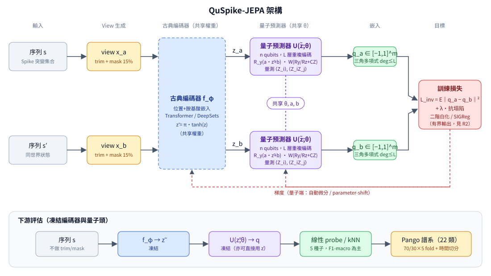
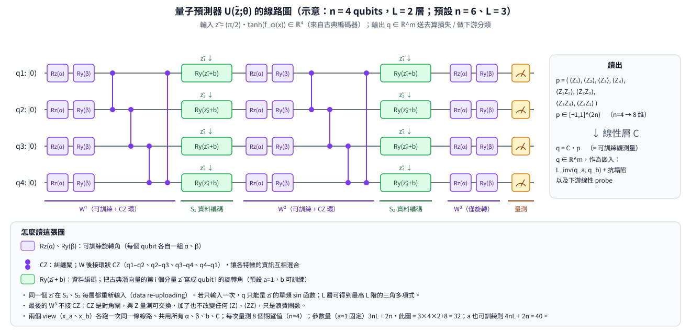

# QuSpike-JEPA：用於潛在 Spike 胺基酸序列分類的量子聯合嵌入架構

> 狀態：已完成三輪實驗（程式在 `Research/QuSpike_JEPA/`；v1 結果見 `Results/quspike_jepa/report.md`、v2 見 `Results/quspike_jepa_v2/`、v3 見 `Results/quspike_jepa_v3/report.md`，規格見 `specs/006-quspike-jepa/`）。
>
> **結論**：沒有任何 JEPA 設定勝過「對齊突變特徵 + 監督線性分類」這個參考（11 類 0.843、22 類 0.747 test macro F1）。原提案的 H1–H4 有兩項被否證、一項的對照組設計無效（§1.2）。依 §1.2 重寫架構與方法後（容量解除 + 跳接 + V-D + 重建項 + 公平對照），**修訂後的 H3′ 與 H4′ 也都被否證**，§9 的停止條件已觸發（§1.3）：在只用 Spike 的譜系分類上，JEPA 預訓練與量子頭都不提供增量，後續應轉向 §8。**本工作因此以負面結果報告，可主張／不可主張的範圍見 §1.4。**
>
> 標 **[修訂]** 的小節是依 v1/v2 數據改寫的架構與方法；其餘為原始提案，其中的「預期」未必成立。
> 任務：Spike 蛋白胺基酸序列 → Pango 譜系（延續 `Research/lineage_baselines` 的 Spike7k 22 類設定，對照 SNN 論文 Table 2：Acc 0.810）。

## 1. 動機與參考文獻整合

| 來源 | 取用的想法 | 對本方法的限制/啟示 |
|---|---|---|
| Balestriero & LeCun, *Proving and Improving the PRH with JEPAs* | JEPA（白化二階抗塌陷）學到「正樣本圖」的譜嵌入；正樣本若是「同一世界狀態的兩個觀測」（good views）則嵌入對齊世界、否則學到 nuisance（Thm 1–3, Prop 1, 3） | 決定正樣本怎麼定義；trimming 為最關鍵旋鈕；SIGReg/梯度裁剪防塌陷 |
| Schuld et al., *Effect of data encoding on expressive power* | 量子模型 = 資料的部分傅立葉級數；頻譜只由編碼閘決定；單次 Pauli 編碼只能學 sin；重複編碼 L 次得度數 L（式 25） | 編碼層數 L 就是模型容量旋鈕；輸入必須重新縮放到週期內；觀測量（observable）要可訓練 |
| Bravo-Prieto et al., *Style-based qGAN* | 潛變數重複編碼進每個量子閘（線性編碼 `φ⁽ˡ⁾z+φ⁽ˡ⁻¹⁾`），嚴格推廣一次性編碼（Thm 1），淺層即可擬合非高斯分佈 | 直接沿用其「全線路重複編碼」作為量子預測器的輸入方式 |
| Jin et al., *QuStyleGAN / DeepQuantum* | 將 Spike 變異編碼為 10-qubit 密度矩陣、量子漸進判別器 | 見 §1.1 的缺陷，本方法刻意避開 |
| Murad et al., *SNN Spike classification* | Spike7k、22 譜系、70/30 + 5 fold、Acc 0.810 / F1w 0.782 / F1m 0.426 | 作為對照基準；F1 macro 偏低 → 類別不平衡是主要難點，須以 macro 指標為主 |
| 研究筆記 §5 | 時間切分、公平比較、number-needed-to-simulate | 本提案的評估協定應遵守 |

### 1.1 為何不沿用 QuStyleGAN 的編碼與指標（重要）
QuStyleGAN 將長度 1024 的 0/1 突變向量 `v` 做 L2 正規化後取 `ρ = |v⟩⟨v|`，即**純態**。此時其保真度公式第二項 `√((1−Trρ²)(1−Trσ²))` 為 0，保真度 = `(v·w)²/(‖v‖²‖w‖²)`。Delta 相對參考序列僅約 21 個突變 / 1024 位，兩條序列只要共享少數熱點（D614G、P681R…）就會有高重疊，且「與歷史序列相似」本身就是被訓練的目標，因此 96%/94% 並不能證明具備預測未來突變的能力（亦無時間切分）。本方法的評估一律用分類指標 + 時間切分，並報告與簡單基準（參考序列、最近鄰）的差距。

### 1.2 兩輪實驗的結果與診斷 [修訂]

v1 用 `dataset.tsv`（11 類、17,258 條，**不是本文件 §2 寫的 22 類**），v2 用 `dataset_v2.tsv`（22 類、31,689 條）。以下 test macro F1。

**(a) 參考線比所有 JEPA 設定高。** 「對齊突變 token 的 0/1 向量 + softmax 線性分類」（無預訓練、無量子、無編碼器）：11 類 0.843、22 類 0.748。v1 最好的 JEPA 是 `quantum_n6L3` 0.682；v2 最好的是量子 fine-tune 0.709。005 的 onehot 基準（11 類 0.829）因為沒有先對齊參考序列、Delta 的 156–158 刪除會讓後續位置錯開，實際上低估了這條參考線。

**(b) JEPA 預訓練的收益在 fine-tune 後消失。** 22 類、seed 0：

| 設定 | 凍結嵌入 + probe（val） | fine-tune（val） | fine-tune（test） |
|---|---|---|---|
| 量子，有預訓練 | 0.511 | 0.727 | 0.696 |
| 量子，不預訓練（scratch） | 0.281 | 0.728 | **0.709** |
| 古典，有預訓練 | 0.197 | 0.706 | 0.681 |
| 古典，不預訓練 | 0.159 | 0.688 | 0.666 |

預訓練確實讓凍結嵌入變好（0.281→0.511），但 fine-tune 之後差異消失甚至反轉。即 JEPA 學到的東西，監督式訓練自己就能學到，而且更快（預訓練 130 秒 + fine-tune 47 秒 vs 只要 47 秒）。

**(c) H3 的對照組無效。** 量子線路 66 個參數、參數量匹配的古典頭 69 個，但**編碼器有 104,134 個參數，頭只佔全模型 0.06%**。兩組的編碼器完全相同。而且匹配到 66 個參數時古典頭的隱藏層只有 **3 個單元**——那是瓶頸，不是對照。所以 v1「量子 0.682 vs 古典 0.364」不能當成參數效率的證據，v2 的差距（0.696 vs 0.681、0.709 vs 0.666）才是在同一容量下的比較，量子仍略高但幅度小得多。

**(d) 消融的方向一致指向「破壞越少越好」。** v1 val macro F1：`mask_ratio` 0.05→0.430 優於 0.15→0.322；`min_mutations` 1→0.410 優於 3→0.322、6→0.307；`variant` self_distort 0.382 優於 same_lineage 0.321。每條序列只有 20–40 個突變，遮掉 15% 就是遮掉 3–6 個，而譜系正是由少數專屬突變定義的。**不變性目標正在移除標籤訊號本身。**

**(e) 量子線路的額外結構沒有貢獻。** `entangle=False` 0.666 ≥ 預設 0.641；`trainable_obs=False` 0.684 ≥ 0.641；`n_layers` 2→0.674 之後飽和（3→0.662、4→0.676）。但 `n_qubits` 單調上升（4→0.564、6→0.650、8→0.677、10→0.686）。合起來看：量子頭目前的作用更像**有界的隨機特徵展開**，收益來自寬度（n），不是深度（L）、糾纏或可訓練觀測量。

**(f) 瓶頸在 k = n。** 編碼器把 3,686 維的突變指標壓成 6 維潛向量、12 維讀出，再做 22 類分類。監督線性模型直接吃 3,686 維就有 0.748。

**(g) 有效秩不是品質訊號。** 量子有預訓練 rank 10.28 → F1 0.696；不預訓練 rank 3.04 → F1 **0.709**。v1 的 `whitening=identity`／`none` macro F1 僅 0.11–0.12（接近隨機）卻沒被標為塌陷。

**(h) 天花板。** 把突變組合相同的序列歸為一組、每組都猜多數標籤（偷看標籤，是樂觀上限）：22 類 test macro F1 0.930（minc=1，3,686 個特徵）、0.917（minc=3）、0.890（minc=10）。**此上界很鬆，須如此陳述 [2026-11-15 修正]**：minc=1 時 57.3% 的測試序列擁有獨一無二的突變簽章，oracle 對它們等於直接讀出答案（minc=10 時仍有 38.0%）。改用不偷看測試標籤的版本——以 train 的「簽章 → 多數標籤」查表預測 test——命中率只有 42.1%（時間切分使較晚序列帶有未見過的突變組合），macro F1 僅 **0.411**。故三個數字應並列：精確簽章查表 0.411（可實現但脆弱）、監督線性 0.747（可實現）、oracle 0.890–0.930（鬆上界，含大量記憶成分）。所以**只用 Spike、22 類，0.9 以上缺乏可行性依據**；0.748 → ~0.93 是**上界的差距，不是可達成的空間**，而損失集中在 Delta 母譜系對子譜系（B.1.617.2 0.495、AY.44 0.439、AY.103 0.483、AY.4 0.491）與 B.1 系（B.1.1 0.290、B.1 0.474、B.1.2 0.671）。

**修訂方向**（對應下文）：§3.1–3.2 解開 k = n 的瓶頸並加入跳接，使參考線成為結構上的下限；§3.3 加入重建項，§3.4–3.6 把不變性目標從「突變內容」改成「定序 nuisance」；§5 換掉無效的對照組並加入天花板；§4 重寫假說。

### 1.3 第三輪（v3）：修訂後的實驗結果 [修訂]

修訂項目全部實作完成（M5–M7）：d_z 與 n 解開（d_z=128）、H=8 並聯量子頭（m=128）、跳接 `W_s`、V-D 視角、重建項 μ=1、寬度匹配古典頭、方差塌陷檢查、簽章天花板。22 類、3 種子、`--final`，結果在 `Results/quspike_jepa_v3/report.md`。

| 設定 | test macro F1 | 距參考線 | 訓練秒 |
|---|---|---|---|
| 參考線（監督線性，跳接單通道） | **0.747±0.000** | — | 1 |
| 寬度匹配古典 + 跳接，不預訓練 | 0.740±0.005 | −0.007 | 19 |
| 量子 H8 + 跳接，不預訓練 | 0.733±0.009 | −0.014 | 141 |
| 寬度匹配古典 + 跳接，有預訓練 | 0.728±0.006 | −0.019 | 48 |
| 量子 H8，只有 q 通道，不預訓練 | 0.722±0.004 | −0.025 | 140 |
| 量子 H8 + 跳接，有預訓練 | 0.718±0.007 | −0.029 | 290 |
| 量子 H8，只有 q 通道，有預訓練 | 0.677±0.008 | −0.070 | 346 |

**(i) H3′ 跳接增量為負，不成立。** 量子 −0.014、寬度匹配古典 −0.007，都在雜訊內（±0.020），**沒有任何設定超過參考線**。把參考線做成結構下限（`W_q=0` 即可還原）之後仍然如此，說明 q 通道提供的不是互補資訊，而是會干擾跳接通道的噪聲。

**(ii) H4′ 預訓練貢獻仍為負，V-D 與重建項沒有救回來。** both 通道 −0.015（量子）／−0.012（古典）在雜訊內；**只有 q 通道時 −0.045，超過雜訊，是明確的傷害**。§3.3 設定的判準（「若 μ 怎麼調都無法讓 (2)−(3) 轉正，應結論此任務不適合 JEPA 式預訓練」）已達成否證條件。

**(iii) 用公平對照後，量子頭沒有優勢。** 同一讀出寬度 m=128 下，量子 − 寬度匹配古典 = −0.007（不預訓練）／−0.010（預訓練），都在雜訊內。這修正了 v1 的假象（「量子 0.682 vs 古典 0.364」）：那個差距來自古典頭只有 3 個隱藏單元，不是量子結構。注意寬度匹配古典頭的參數量**多於**量子線路（281,536 vs 量子線路 512），所以這裡否證的是「量子歸納偏置在同讀出寬度下有幫助」，不是參數效率。

**(iv) 成本差三個數量級。** 參考線 1 秒、寬度匹配古典 19–48 秒、量子 140–346 秒，而分數由高到低正好相反。

**(v) 真正的差距在哪（分群，對照 §1.2(h) 的群天花板）：**

| 群 | 最佳觀測值 | 群天花板 | 差距 |
|---|---|---|---|
| b1_family（B.1／B.1.1／B.1.2／B.1.177） | 0.542 | 0.921 | **−0.379** |
| delta_parent（B.1.617.2） | 0.527 | 0.836 | −0.309 |
| delta_sub（AY.*） | 0.616 | 0.876 | −0.260 |
| others（11 類） | 0.918 | 0.971 | −0.053 |

剩餘空間集中在 B.1 系與 Delta 母／子譜系，且這些群的天花板本身就低於 1，證實 §7-R8：這些界線主要不由 Spike 決定。

**(vi) §9 停止條件已觸發。** 跳接增量（−0.014）與預訓練貢獻（−0.015）在 3 種子下都未超過 +0.02。依文件自訂的判準，**結論為「在只用 Spike 的譜系分類上，JEPA 預訓練與量子頭都不提供增量」，應轉向 §8 的擴充方向，不再在本任務上調參。**

**與文件的偏離（實作時發現）**：§5 原寫「任一維度的標準差低於閾值即標示塌陷」，但 m=128 的並聯讀出本來就含近乎恆定的可觀測量（實測最小維度標準差 2.2×10⁻⁶），該規則會誤標健康的執行；改為「標準差低於閾值的維度**比例** > 0.5」才算塌陷，最小值與死維度比例只作診斷（`loss.dead_dim_frac`）。另外塌陷是**預訓練表徵**的診斷，fine-tune 會重訓編碼器，故不據此排除 fine-tune 的任務分數（`summary.collect`）。

### 1.4 定位：以負面結果報告 [修訂]

三輪實驗的結論是負面的。這一節把「數據支持什麼、不支持什麼」釘死，避免後續引用時超出證據範圍。

**(1) 可主張（有有效對照組支持）**

- **JEPA 式預訓練對任務分數沒有貢獻。** fine-tune 減 scratch fine-tune（§2 協定 (2)−(3)）：both 通道 −0.015（量子）／−0.012（古典），在雜訊內；**只有 q 通道時 −0.045，超過雜訊下限，是明確的傷害**。加入 V-D 視角與重建項（μ=1）之後仍然如此。
- **同容量下量子頭沒有優於古典頭。** 固定讀出寬度 m=128、同通道、同視角、同 fine-tune 協定、3 種子：量子 − 寬度匹配古典 = −0.007（不預訓練）／−0.010（預訓練），皆在雜訊內，且訓練時間為 6–7 倍（141 s vs 19 s、290 s vs 48 s）。
- **v1 看似巨大的量子優勢是對照組缺陷造成的假象。** 「量子 0.682 vs 古典 0.364」源自參數量匹配把古典頭壓到 3 個隱藏單元，而頭只佔全模型 0.06%（§1.2(c)）。這條方法學警示本身值得報告：在「量子頭 + 古典編碼器」的混合架構中，對頭做參數量匹配等於對照一個瓶頸。
- **本線路的實際角色是有界、週期性的隨機特徵展開**，不是在利用糾纏或高次傅立葉分量：關閉糾纏（0.666±0.088）與關閉可訓練觀測量（0.684±0.004）都不比開啟（0.641±0.068）差，即這兩項**沒有可檢出的貢獻**（差異落在種子標準差內，不足以宣稱為負貢獻）；L 在 2 就飽和；只有寬度 n 的上升超過標準差（§1.2(e)）。
- **任務本身有上界，且剩餘差距不在模型。** 簽章 oracle 給出 22 類 0.930；最簡單的「對齊突變指標 + 監督線性」已達 0.747（1 秒）。剩下的差距集中在群天花板本身只有 0.836–0.921 的 B.1 系與 Delta 母／子譜系（§1.3(v)），即這些界線主要不由 Spike 決定。

**(2) 不主張（證據不足或超出設定）**

- **不主張參數效率**，連否證也不主張：寬度匹配古典頭的參數量（281,536）遠多於量子線路（512），但分數更高。要談參數效率必須在**同分數**下比參數，而量子設定從未達到同分數，所以這個比較在本實驗中無法成立。
- **不主張「JEPA 不適用於生物序列」**。被否證的是一個具體組合：以「突變內容不變性」為目標、在只用 Spike 的 22 類譜系分類上、以本文的視角與損失實作。
- **H1′（視角排序 V-D > V-C > V-A）與 H2′（H 軸上寬度優於深度）在修訂後架構下未測。** v3 的 7 個設定全部是 V-D、H=8，沒有掃這兩條軸；H2′ 只有 v1 的 n／L 消融作間接支持。報告中不得把它們寫成已驗證。
- 原本就列為不主張的項目仍然有效（§4.2 末）：量子加速、量子優勢、對未來突變的預測能力、以及在「只用 Spike、22 類」下 macro F1 ≥ 0.9。

**(3) 為何這個負面結果站得住**

- **對照組有效**：寬度匹配（非參數量匹配）古典頭、scratch fine-tune、只有 `W_q`／只有 `W_s` 的單通道消融，且監督線性參考線被做成**結構下限**（令 `W_q = 0` 即可還原），所以「追不上參考線」不能歸因於優化難度。
- **有任務上界**：簽章 oracle 把「還差多少」變成可量化的量，0.733 不會被誤讀成接近飽和，也不會被誤讀成模型失敗。
- **判準事前訂好**：§9 的停止條件（增量須 > 0.02，約為 §7-R7 的 GPU 噪聲下限）與「≥3 種子」是在跑 v3 之前寫進文件的，結論不是事後挑的。
- **否證過程修掉了三個常見缺陷**，這部分可獨立報告：參數量匹配的對照組（§1.2(c)）、把凍結 probe 當任務分數（§2 的三協定）、用有效秩當塌陷判準（§1.2(g)，改用 `loss.dead_dim_frac` 並區分預訓練表徵與 fine-tune 任務分數）。

**(4) 建議的報告形式**：定位為「在一個有標籤歧義上界、且有強簡單基準的生物序列分類任務上，對量子歸納偏置與 JEPA 預訓練做有效對照的研究」。主結果是 §1.3 的對照表與 §1.3(v) 的天花板分解；敘述中不出現「優勢」「超越」，並在摘要就給出參考線 0.747 與上界 0.930 這兩個錨點。

## 2. 問題設定

- 輸入：對齊至 Wuhan-Hu-1 的 Spike 胺基酸序列 `s ∈ 𝒜^{L_s}`（L_s≈1273，含 gap）。「latent spike」指本方法不直接對序列做量子處理，而是先壓成低維潛向量 `z ∈ ℝ^k`。
- 標籤：Pango 譜系 `y ∈ {1..22}`；一律用 `dataset_v2.tsv`（22 類）。v1 誤用 11 類的 `dataset.tsv`，其數字不可與 22 類結果並列。
- **三種評估協定並列報告 [修訂]**（原本只有凍結 probe，導致「預訓練有用」的錯誤印象，見 §1.2(b)）：
  1. **凍結 probe**：凍結編碼器 + 線性 probe / kNN。衡量表徵品質，但不是任務分數。
  2. **fine-tune**：編碼器 + 量子頭 + 線性分類層整體以交叉熵訓練（`Research/QuSpike_JEPA/finetune.py`，`--finetune`）。這是任務分數。
  3. **scratch fine-tune**（必備對照）：同樣架構、同樣 fine-tune，但跳過預訓練（`--epochs 0`）。**(2) 減 (1) 衡量表徵品質，(2) 減 (3) 才是預訓練的真實貢獻。** 任何「預訓練有用」的說法都必須附上 (3)。

## 3. 架構



文字版：

```
 序列 s ──trim/mask──▶ view x_a ─▶ ┌───────────┐ z_a ─▶ [Quantum Predictor U(z;θ)] ─▶ q_a ┐
                                    │ 古典編碼器 f │                                        ├─ L_inv(q_a, q_b)
 序列 s'(同世界狀態) ──▶ view x_b ─▶ │ (共享權重)  │ z_b ─▶ [Quantum Predictor U(z;θ)] ─▶ q_b ┘   + SIGReg(q)
                                    └───────────┘
 下游：q（或 z）→ 線性 probe → 譜系
```

### 3.1 古典編碼器 `f_φ`
- 輸入表示：突變稀疏表示（相對參考的 (位置, 胺基酸) 集合）→ 位置嵌入 + 胺基酸嵌入 → 小型 Transformer / DeepSets（突變是集合而非長序列，且 1273 長度大多為保守位）。亦可選 ESM-2 凍結特徵作為對照。
- **輸出維度與量子位元數解開 [修訂]**。原設計 `k = n_qubits`（6–10），使編碼器把約 3,700 維的突變指標壓成 6 維才進量子頭；§1.2(f) 顯示這就是瓶頸。改為：
  - 編碼器輸出寬潛向量 `u ∈ ℝ^{d_z}`，`d_z ∈ {64, 128, 256}`，與 n 無關。
  - 再以線性「角度映射」`A: ℝ^{d_z} → ℝ^{H·n}` 產生 H 個量子頭所需的角度（§3.2），逐角度縮放 `z̃ = (π/2)·tanh(A u)`。
  - 這樣 n 只決定單一量子頭的寬度，不再決定整個模型的資訊瓶頸；「加大 n」與「加大表徵容量」成為兩個獨立旋鈕，H3／R3 才能分開檢驗。
- 縮放仍用 `(π/2)·tanh`，使 z̃ ∈ (−π/2, π/2)，落在 R_y 週期（2π）內且不會首尾重疊（Schuld 結論 3：資料需縮放進週期）。注意不可用 `π·tanh(z)`：R_y(π) 與 R_y(−π) 只差全域相位，可觀測量完全相同，編碼器輸出飽和時兩個極端會被映成同一點。另可對 z 加小幅正則避免 tanh 飽和。

### 3.2 量子預測器（核心新穎處）

#### 線路結構


設 z̃ ∈ ℝ^k，取 n = k：一個特徵對應一個量子位元（初期 n = 6、L = 3）。每層重新編碼 z̃（data re-uploading + style-qGAN 式線性編碼）；只編碼一次的模型只能學單頻 sin（Schuld）。

```
|0⟩^n ─ W¹ ─ S₁(z̃) ─ W² ─ S₂(z̃) ─ … ─ W^L ─ S_L(z̃) ─ W^{L+1} ─ 量測

S_l(z̃) = ⊗_i R_y( a_{l,i}·z̃_i + b_{l,i} )      資料編碼（式 5 的權重/偏置）
W^l    = ⊗_i [ R_z(α)·R_y(β) ]，後接 CZ 環（q₁–q₂–…–q_n–q₁）   可訓練區塊
```
- 兩個 view 共用同一組 θ、a、b（孿生結構）。
- 參數量：W¹…W^L 各 2n 個旋轉角、最後 W^{L+1} 另 2n、每層編碼的偏置 b 共 n。預設（a=1 固定）總計 **3nL + 2n**（n=6, L=3 → 66）；a 也可訓練時為 4nL + 2n（→ 78）。
- k > n 時：每個位元可編碼兩個特徵（R_y 與 R_z 各一個，即 Schuld 的 parallel encoding），或增加位元。

#### 讀出
- 量測 Pauli 期望值 `p`：⟨Z_i⟩ 共 n 個 + 環上相鄰 ⟨Z_iZ_{i+1}⟩ 共 n 個，故 m = 2n（n=6 → 12）。
- 再接線性映射 `q = C·p`。期望值對觀測量為線性，故這等價於**可訓練觀測量** `M_j = Σ_P c_{jP}·P`（Schuld 結論 5），且不需額外線路執行。
- `q` 有界：|p| ≤ 1，q 的範圍由 C 決定。這是 §7-R2「白化與有界輸出」的來源。

#### 頻譜性質（可驗證，須區分兩種設定）
每個特徵 z̃_i 在第 i 個位元上被重複編碼 L 次。
- **預設：固定 a = 1**（只訓練 b 與 W）。頻率為整數，`q` 的每個分量是 z̃ 的三角多項式，**度數 ≤ L**（Schuld 式 25），可用傅立葉分析檢驗。L=1 退化為單頻 sin，作為 sanity ablation（H2）。
- **變體：a 可訓練**。頻率變為 `Σ_l ε_l·a_{l,i}`（ε ∈ {−1,0,1}），每個特徵最多 3^L 個、一般為非整數，**不再是標準傅立葉級數**，Schuld 的整數頻譜分析不直接適用，也不能再宣稱「度數 ≤ L」。此變體可學頻率匹配，但僅作消融，結論須另行以數值方式檢驗頻譜。

#### 訓練與成本
- **模擬**：n ≤ 10 時狀態向量僅 2^n 維，以 torch 複數張量對 batch 模擬並自動微分，成本約 O(L·n·2^n·B)。
- **真機梯度**：parameter-shift，每個參數出現一次需 2 次線路執行；梯度要回傳編碼器，故 z̃ 的每次編碼也要 shift。每個樣本約 2·(4nL + 2n + nL) 次執行，再乘 shots。
- **有限 shots**：S = 1024 時每個期望值標準誤差約 1/√S ≈ 0.03，會污染白化用的共變異估計；噪聲/shots 消融須特別觀察。
- **初始化**：a = 1、b = 0，W 用小角度（σ ≈ 0.1）；n ≤ 10 時 barren plateau 影響不嚴重。

#### 讀出容量：並聯多頭取代加深 [修訂]

原設計讀出 m = 2n（n=6 → 12 維），且 k = n。v1 消融的結論很一致（§1.2(e)）：收益來自**寬度 n**（4→0.564、6→0.650、8→0.677、10→0.686，單調上升），而深度 L 在 2 之後就飽和（1→0.586、2→0.674、3→0.662、4→0.676），糾纏與可訓練觀測量關閉後不比開啟差（`entangle=False` 0.666±0.088、`trainable_obs=False` 0.684±0.004，對比預設 0.641±0.068；差異在種子標準差內，故判為「無可檢出貢獻」而非負貢獻）。也就是說，量子頭目前的實際角色是**有界、週期性的隨機特徵展開**，不是在利用糾纏或表達高次傅立葉分量。

因此改為「**並聯加寬**」而非「加深」：

```
u ∈ ℝ^{d_z} ──A──▶ z̃ ∈ ℝ^{H×n} ──▶ ┌ U(z̃⁽¹⁾; θ⁽¹⁾) ─▶ p⁽¹⁾ ∈ ℝ^{2n} ┐
                                      │ U(z̃⁽²⁾; θ⁽²⁾) ─▶ p⁽²⁾        ├─ concat ─▶ p ∈ ℝ^{H·2n} ─▶ C ─▶ q
                                      └ …（H 個，θ 不共用）          ┘
```

- **預設改為 n=8、L=2、H=8** → 讀出 m = H·2n = 128 維（原為 12）。線路參數 H·(3nL+2n) = 8·(48+16) = 512，仍遠小於編碼器。
- 每個頭的 θ 獨立（不共用），角度映射 A 讓不同頭看到潛空間的不同方向；H 個 2^n 狀態向量可一次批次模擬，n=8 時 2^8=256 維，成本仍低。
- 糾纏與可訓練觀測量**預設關閉**（依 v1 消融），只在消融中開啟。
- `n_layers` 預設降為 2（飽和點），把預算從 L 移到 H。

#### 跳接：讓參考線成為結構下限 [修訂]

§1.2(a) 顯示「突變指標 + 線性分類」就有 22 類 0.748，高於任何 JEPA 設定。只要量子路徑是**唯一**的資訊通道，整個模型就必須重新學會那條參考線才能追上它，而目前學不到。改為把參考線直接接進分類層：

```
logits = W_q · q  +  W_s · x_mut  +  b
```

- `x_mut ∈ {0,1}^{V}` 為對齊後的突變指標（V ≈ 3,700，排除 X；與 `baselines.mutset_linear` 同一組特徵），`W_s` 為稀疏輸入的線性層。
- 這使**監督線性參考線成為架構上的下限**（令 `W_q = 0` 即可還原它），量子路徑只需要提供「參考線之外的增量」。
- 判準改為增量而非絕對值：`macro F1(q + x_mut) − macro F1(x_mut only)`。若增量為 0，結論就是量子頭對這個任務沒有貢獻——這是誠實且可報告的結果，而不是被參考線淹沒的 0.70。
- 風險：`W_s` 容量遠大於量子路徑，梯度會偏向走捷徑。對策是對 `W_s` 施加較強的 weight decay，並加跑「只有 `W_q`」與「只有 `W_s`」兩個單通道消融，確認增量不是來自容量而是來自量子特徵。

#### 角色與對照
- 因 Balestriero 的理論假設預測器為 identity，本方法**把量子線路視為共享的非線性投影頭**（兩個 view 經同一 U），而非條件式預測。若要做成真正的 JEPA predictor（由 context 預測 target 嵌入，含條件變數，如演化時間間隔，可在 W 之間加第二組編碼閘），列為擴充（見 §8），其對 Thm 1 的適用性不在原理論涵蓋範圍內。
- 對照組 **[修訂]**：**寬度匹配**的古典 MLP 頭（隱藏層 = 讀出維度 m）；同一線路但 L=1。原本的「參數量匹配」頭在 n=6、L=3 下隱藏層只有 3 個單元，是瓶頸而非對照，已依 §1.2(c) 降級為瓶頸示例。

### 3.3 損失 [修訂]

原設計只有不變性 + 白化：`L = E‖q_a − q_b‖² + λ·VICReg(q)`。§1.2(d) 顯示這組目標在這個任務上會**移除標籤訊號**——破壞越少分數越高，極限就是「不要做 JEPA」。原因是譜系由少數專屬突變定義，而不變性項的作用正是讓表徵對那些突變的有無不敏感。

加入**重建（去噪）項**，讓被遮蔽的突變必須可從潛向量還原：

```
L = E‖q_a − q_b‖²  +  λ·VICReg(q)  +  μ·L_recon
L_recon = BCE( g(u_a), x_mut )          # 由潛向量預測完整突變指標（含被遮蔽者）
```

- `g: ℝ^{d_z} → ℝ^{V}` 為輕量解碼頭，只在預訓練時存在。
- 不變性項讓表徵對定序 nuisance 不變（§3.4 的 V-D），重建項則防止它把突變內容一起丟掉。兩者的張力由 μ 控制，須掃 μ ∈ {0, 0.1, 1, 10}；**μ=0 即退化為目前已被否證的設定**，是消融的必要端點。
- 判準：重建項要能把「凍結 probe」與「scratch fine-tune」的差距（§1.2(b)：0.281 vs 0.728）縮小。若 μ 怎麼調都無法讓 (2) 減 (3) 轉正，應結論「此任務不適合 JEPA 式預訓練」並停止這條路線。
- `q ∈ [−1,1]^m` 有界：標準 Gaussian 目標的 SIGReg 與有界支撐不相容；維持**二階白化 + 方差/共變異懲罰（VICReg 式）**，不要求高斯。v1 證實這一項是必要的：`whitening=vicreg` 0.321 vs `identity` 0.123、`none` 0.114。
- 梯度：量子部分用 parameter-shift（硬體）或狀態向量模擬的自動微分（初期）。

### 3.4 正樣本（views）— 決定成敗
依 Balestriero 的 good/bad view 區分，設計三種變體並比較：

| 變體 | 正樣本 | 標籤使用 | 屬性 |
|---|---|---|---|
| **V-A 譜系正樣本** | 同一 Pango 譜系的兩條不同序列（再各自 trim/mask） | 用譜系做分組，不用分類頭 | 對應 good view；但等同弱監督，不可宣稱純自監督 |
| **V-B 親緣鄰居正樣本** | 同一時間窗內 Hamming/突變距離 ≤ d 的序列（Nextstrain 樹的近鄰） | 不用譜系標籤 | 真正自監督；正樣本圖近似演化圖 |
| **V-C 單序列破壞（bad view）** | 同一序列的兩次 mask/突變抖動 | 無 | 對照組；預期學到序列 nuisance（如 gap/N 位置、定序品質） |

**實測結果與修訂 [修訂]**：H1 的預期是 V-A、V-B 優於 V-C（V-C 為 bad view）。v1 實測（val macro F1）**方向相反**：V-C self_distort 0.382 > V-B neighbor 0.340 > V-A same_lineage 0.321。被當成對照組的 bad view 反而最好。

解釋：V-A 取同譜系的**兩條不同序列**，它們的差異正是子譜系內部的變異；要求嵌入對這個差異不變，等於要求嵌入丟掉區分子譜系的資訊——而那正是 22 類任務中最難、損失最集中的部分（§1.2(h)）。V-C 只破壞同一條序列，不要求跨序列不變，所以傷害最小。

因此新增 **V-D（只對定序 nuisance 不變）**，並以它取代 V-A 成為主設定：

| 變體 | 正樣本 | 不變於什麼 | 不變於什麼（禁止） |
|---|---|---|---|
| **V-D 定序 nuisance** | 同一序列的兩次「定序層級」破壞 | X/N 連續缺失（amplicon dropout）、首尾截斷、定序品質 | **不得遮蔽或丟棄任何突變的身分** |

- 具體做法：只注入 §3.5 的第 3 層（連續缺失）與首尾截斷，**不做**第 1、2 層的突變／位置遮蔽。
- 這讓不變性目標對齊一個真實存在、且與標籤無關的 nuisance（資料中 45–52% 的序列含 X，每條平均 8 個、最多 63 個），而不是對齊「突變有無」。
- 預期：V-D > V-C > V-B > V-A。這個排序本身就是對 Balestriero good/bad view 框架的檢驗——此處「好視角」的判準不是「是否同一世界狀態」，而是「不變性是否落在與標籤正交的方向上」。

trim 對應「保留兩觀測共享的資訊」：隨機保留突變子集（global 50–100%、local 15–50%）再遮罩 15%。**[修訂]** V-D 不使用突變層級的 trim；global/local trim 只作用在位置軸的連續區間，且區間內的突變全部保留。

### 3.5 Trim / Mask 的具體設計

**輸入表示**：相對 Wuhan-Hu-1 的突變集合 `{(位置, 胺基酸/刪除)}`（通常 20–40 個），對齊後約 1273 位。

**Trim（取區段）**
- 在位置軸取一段連續區間：global view 保留約 50–100% 的位置，local view 約 15–50%；區間外的突變丟掉。
- 邊界可選擇對齊 NTD / RBD / S2 結構域，或純隨機。
- 區間須至少含 k 個突變（暫定 k=3），取不到則重取，避免 local view 為空集合。

**Mask（三層）**
1. 突變層級：隨機把約 15% 的突變換成 `[MASK]`，保留位置。
2. 位置層級：在保留區間內再遮約 15% 的位置，**包含與參考相同的位點**。須標成 `[MASK]` 而非直接丟掉，否則模型會把「未知」誤認為「等於參考」，產生假訊號。
3. 連續缺失（可選）：模擬真實定序的 N/X 連續缺失（amplicon dropout），遮 20–100 位連續區段，使表徵對定序品質這個 nuisance 不變。

**已知問題**：每條序列僅 20–40 個突變，15% 約 3–6 個；親緣近的譜系（如 AY.4 vs AY.12）可能只靠少數突變區分，遮到關鍵突變時 V-A 的兩個 view 就失去可對齊的共同資訊。因此 mask 比例為超參數，須消融。兩個 view 各自獨立抽樣並固定亂數種子。

**實測確認此問題成立，並修訂預設 [修訂]**：v1 消融（val macro F1）`mask_ratio` 0.05→0.430、0.15→0.322、0.3→0.371、0.5→0.350；`min_mutations` 1→0.410、3→0.322、6→0.307；`mask_level` position 0.383 > both/mutation 0.321 > span 0.286。三條軸都指向「少遮、且不要遮突變身分」。修訂：

- **突變層級（第 1 層）預設關閉**（`mask_mut = 0`）。它直接刪掉標籤訊號，是三層中傷害最大的。
- **位置層級（第 2 層）預設 ρ = 0.05**（原 0.15），且只遮「與參考相同」的位點——這類位點本來就不帶譜系資訊，遮它才符合「對未觀測不變」的原意。實作上必須標成 `[MASK]` 而非丟棄，否則模型會把「未知」誤認為「等於參考」。
- **連續缺失（第 3 層）升為主要破壞來源**，比例提高到真實分佈（依資料中 X 的實際長度分佈抽樣，而非固定 20–100 位）。這是 V-D 的核心。
- `min_mutations` 預設降為 1（原 3）。要求 view 至少保留 3 個突變，會系統性排除突變數少的序列（早期 B.1 系正是如此），而那些類別的 F1 最低（B.1.1 0.290、B.1 0.474）。

### 3.6 遮蔽分佈 P_M：從隨機到可學習

Mask 並不一定要均勻隨機。依 Balestriero Thm 4，view 的分佈決定正樣本圖（世界核），所以 P_M 本身是設計旋鈕。而且突變資訊量差異很大：D614G 幾乎所有序列都有，遮掉無損失；譜系專屬突變才是關鍵。分三階段：

| 階段 | P_M | 說明 |
|---|---|---|
| P0 | 均勻隨機 | 基準 |
| P1 | 資料導出的固定先驗 | `p_i ∝` 位點變異度（IDF 或條件熵）：高頻突變多遮、稀有突變少遮；不需訓練，成本低 |
| P2 | 學習式對抗 mask | 如下 min-max，作為擴充 |

**P2 目標**：不能直接最小化 L_inv（最小化結果是什麼都不遮，為平凡解），須與編碼器對抗（參考 ADIOS, Shi et al. 2022；InfoMin, Tian et al. 2020）：

```
min_{φ,θ}  L_inv(q_a, q_b) + λ·SIGReg(q)                      # 編碼器 + 量子頭
max_{ψ}    L_inv(q_a, q_b) − β·(E|m|/N − ρ)² − γ·R_keep         # mask 模型 P_ψ
```

- `p_i = σ(g_ψ(x)_i)` 為每個突變的遮蔽機率；離散抽樣用 Gumbel-softmax 或 REINFORCE。
- 第二項為預算約束（目標遮蔽比例 ρ，如 15%），避免全遮；`R_keep` 保證每個 view 至少保留 k 個突變。
- mask 模型為古典網路，不增加量子端成本。

**風險**
1. min-max 不穩定，且疊加 JEPA 本身的塌陷風險（見 R2）。
2. 對抗式 mask 可能專遮區分譜系的突變，使不同譜系序列的 view 趨同，等同 Balestriero Fig 3c 的 strong bad view，正樣本圖混入跨譜系邊；預算約束只能緩解，不能保證。
3. 若同時引入量子頭與學習式 mask，效果難以歸因；須在同一預算 ρ 下與 P0、P1 逐項比較。

P1 先回答「非均勻 mask 有沒有用」；若 P1 無收益，P2 的複雜度不值得。

**實測與決議 [修訂]**：v1 的 `mask_dist` 消融：P1（variability）0.359 vs P0（uniform）0.321，差距 0.038 在種子標準差（±0.104／±0.061）之內，**不確定**。而同一輪實驗顯示整體遮蔽預算應該大幅調降（§3.5），P_M 的形狀在 ρ=0.05 的預算下影響空間本來就小。

依原本訂下的判準（「若 P1 無收益，P2 的複雜度不值得」），**P2 取消**。理由除了 P1 收益不明，還有 §3.6 風險 2 已被 §1.2(d) 間接證實：對抗式 mask 的最優策略正是去遮譜系專屬突變，而這正是這個任務最不能遮的東西——min-max 會主動找到最傷害下游的遮法。保留 P0 與 P1 作為消融的兩個端點即可。

## 4. 與假說的連結（可檢驗）

### 4.1 第一輪的結果 [修訂]

| 假說 | 預期 | 實測 | 判定 |
|---|---|---|---|
| **H1** V-A、V-B 的 macro-F1 > V-C | good view 優於 bad view | V-C 0.382 > V-B 0.340 > V-A 0.321（v1 val） | **否證**（方向相反，見 §3.4） |
| **H2** 度數 L 上升後飽和，L=1 明顯較差 | 單調上升至飽和 | L=1 0.586、L=2 0.674、L=3 0.662、L=4 0.676 | **成立但飽和點極早**（L=2），故把預算移到 H（§3.2） |
| **H3** 同參數量下量子頭 ≥ 古典頭 | 量子不劣於古典 | v1 0.682 vs 0.364；但頭只佔全模型 0.06%、古典頭隱藏層僅 3 單元 | **對照組無效**，不能作為參數效率的證據（§1.2(c)）。v2 同容量下 0.696 vs 0.681、0.709 vs 0.666，量子略高但幅度小 |
| **H4** probe 的 F1-macro > SNN 的 0.426 | 超過 | v1 quantum 0.682 > 0.426，但簡單參考線 0.843 更高 | **成立但無意義**：超過的是一個弱基準，未超過同資料上的簡單參考線 |

### 4.2 修訂後的假說 [修訂]

把問題從「JEPA/量子能不能做這個任務」改成「它們能否在已知參考線之上提供增量」。所有假說都以 §3.2 的跳接架構、22 類、≥3 種子、fine-tune 協定評估。

- **H1′（不變性的方向）**：V-D（只對定序 nuisance 不變）> V-C > V-A。檢驗的是「不變性是否落在與標籤正交的方向」，而非 good/bad view 的原始分類。
- **H2′（寬度優於深度）**：固定線路參數預算，增加 H（並聯頭數）帶來的增益大於增加 L。若成立，說明量子頭的作用是有界隨機特徵展開，應據此重新定位本工作。
- **H3′（量子特徵的增量）**：`macro F1(q + x_mut) − macro F1(x_mut only) > 0`，且在同一讀出維度 m 下量子頭的增量 ≥ 寬度匹配的古典 MLP 頭。**對照組改為寬度匹配（隱藏層 = m），不再用參數量匹配的 3 單元頭。**
- **H4′（預訓練的真實貢獻）**：fine-tune 分數減 scratch fine-tune 分數 > 0（§2 協定 (2) − (3)）。v2 單種子為 −0.013（量子）／+0.015（古典），皆在噪聲內；**v3 加入重建項（μ=1）與 V-D 後 3 種子仍為 −0.015（量子）／−0.012（古典），只有 q 通道時 −0.045。依本項事前訂下的判準，判定否證**（§1.3(ii)）。
- **H5′（天花板與差距歸因）**：22 類的標籤歧義上限約 0.93（§1.2(h)）。報告任何分數時都須同時給出「距參考線 0.748」與「距上限 0.93」兩個差距，並按譜系群（Delta 母／子、B.1 系、其餘）分解損失。
- 不主張：量子加速、量子優勢、對未來突變的預測能力。**追加不主張**：在「只用 Spike、22 類」的設定下 macro F1 ≥ 0.9；§1.2(h) 顯示那已是標籤歧義上限，要再往上必須加入 Spike 以外的序列資訊。

## 5. 實驗設計

**資料**：(i) Spike7k（GISAID，依論文取得，與現有 `Research/lineage_baselines` 同協定）；(ii) 公開替代：Zenodo 19040165（無譜系標註，需 Nextclade/pangolin 標定）。

**切分**：
1. 重現協定：70/30 × 5-fold（與 Table 2 直接比較）。
2. 時間切分：以採集月份切，訓練期前的序列訓練、之後的譜系/序列測試（含訓練期未出現的子譜系 → 衡量泛化而非記憶）。

**基準 [修訂]**（皆同一 backbone、同一協定；粗體為新增或改寫）：
- 論文基準：SNN、RP/GAF + CNN、LSTM、Autoencoder+NTK（已在 repo 中）。
- **對齊突變特徵 + 監督線性分類（`mutset_linear`）**：這是真正要超越的參考線（22 類 0.748、11 類 0.843）。原提案沒有這一項，導致第一輪把 005 的 onehot（未對齊、0.829）誤當成天花板。
- **寬度匹配古典頭**（隱藏層 = 讀出維度 m）：取代原本的「參數量匹配」頭。參數量匹配版（隱藏層 3 單元）保留，但只作為瓶頸示例，**不得當作對照組**。
- **scratch fine-tune**（同架構、不預訓練）：§2 協定 (3)，衡量預訓練貢獻的必備對照。
- **標籤歧義上限**（簽章 oracle，22 類 0.930）：上界，不是可達分數。
- 監督式編碼器（上限）、凍結 ESM-2 + probe、隨機初始化編碼器（下限）、最近鄰於突變集合（`mutset_nn`，22 類待補）。

**指標 [修訂]**：Acc、F1-weighted、**F1-macro（主）**、ROC-AUC OvR（沿用論文）；**一律 ≥3 種子的均值 ± 標準差**（v1 實測同設定同種子在 GPU 上重跑的 val macro F1 可差到 0.06，單種子差異不可解讀）；**按譜系群分解損失**（Delta 母／子、B.1 系、其餘）；**同時報告距參考線與距上限的差距**。

嵌入品質：kNN 準確率、有效秩。**有效秩不可單獨作為塌陷判準 [修訂]**——v1 的 `whitening=identity`／`none` macro F1 僅 0.11–0.12 卻未被標為塌陷，v2 的 rank 10.28 反而輸給 rank 3.04（§1.2(g)）。追加兩項檢查：(a) **方差塌陷**：標準差低於閾值的維度**比例** > 0.5 即標示塌陷（`loss.dead_dim_frac`；有效秩用正規化奇異值、與尺度無關，抓不到「變異趨近 0 但仍有殘餘雜訊」。**原訂的「任一維度」版本已證實會誤報**，見 §1.3 末的偏離說明）；(b) **probe 與多數類基準的比較**：macro F1 未明顯高於「全猜最大類」即標示失敗。兩項都是**預訓練表徵**的診斷，不據此排除 fine-tune 的任務分數。

**消融 [修訂]**：
- **H（並聯頭數）∈ {1,2,4,8,16}**（新增，H2′ 的主軸）、n_qubits ∈ {4,6,8,10}、L ∈ {1,2,3,4}。
- **d_z ∈ {64,128,256} 與 n 解開後的交叉掃描**（新增）：確認 R3 的瓶頸是否真的解除。
- **跳接消融**（新增）：只有 `W_q` / 只有 `W_s` / 兩者皆有，確認增量來源。
- **重建權重 μ ∈ {0, 0.1, 1, 10}**（新增，μ=0 為已否證的端點）。
- views **V-A/B/C/D**、糾纏有/無、可訓練觀測量有/無、白化方式、mask 比例（**0/0.05/0.15**）、mask 層級、遮蔽分佈 P0/P1（**P2 取消**，見 §3.6）。

**噪聲/硬體可行性**（第二階段）：shots ∈ {256, 1024, 8192}、去極化/讀出噪聲模擬；有限 shots 下的下游掉點。Bravo-Prieto 顯示淺層加噪聲後 KL 約退化一個數量級，作為預期參考。

## 6. 實作對應（repo）

- `Research/QuSpike_JEPA/`：`views.py`（V-A/B/C，**待加 V-D**）、`encoder.py`／`encoder_cnn.py`、`qhead.py`（狀態向量模擬，torch 自動微分；後續可換 PennyLane/真機）、`loss.py`、`pretrain.py`、`probe.py`、`report.py`。
- **已加入 [修訂]**：`finetune.py`（§2 協定 (2)(3)，`--finetune`／`--ft-epochs`／`--ft-freeze`／`--ft-balanced`）、`baselines.py::mutset_linear`（§5 的監督參考線，`--head mutset_linear`）；結果檔記錄所用資料檔與類別數。
- **已完成（v3）[修訂]**：§3.1 的角度映射 A 與 d_z／n 解開（`encoder.latent`／`pretrain.angle_dim`）、§3.2 的 H 並聯頭（`qhead.MultiQuantumHead`）與跳接 `W_s`（`finetune.Classifier`，`--channels q/skip/both`）、§3.3 的重建頭 g 與 μ（`pretrain.recon_targets`，`--recon`）、§3.4 的 V-D（`views.nuisance_view`）、§5 的方差塌陷檢查（`loss.dead_dim_frac`）、簽章天花板（`ceiling.py`）與譜系群分解＋增量判定（`summary.py`）。測試：`tests/unit/test_qjepa_{revised,ceiling,summary}.py`。
- 重用 `Research/lineage_baselines/{data,metrics,results_io,report}.py` 的資料載入、指標與結果格式，使結果可直接併入 Table 2 對照。
- 測試：`tests/unit/` 加入（a）固定 a=1 時 `q` 對 `z̃` 的傅立葉度數 ≤ L 的數值檢驗（a 可訓練的變體另測頻譜，不套用此斷言）；（b）固定 θ 下 L=1 輸出為單頻；（c）塌陷偵測（有效秩 > 閾值）；（d）view 產生器的標籤一致性。

## 7. 風險與開放問題

- **R1 標籤洩漏／弱監督**：V-A 用譜系分組，須在報告中標明為弱監督；以 V-B 作為主要自監督結論。Pango 譜系本身由突變定義，分類任務與表徵幾乎同源，簡單基準可能已很強。**[已實現]** 最後一句成立且比預期嚴重：簡單參考線（0.748／0.843）高於所有 JEPA 設定。V-A 另有一個未預見的問題——它要求嵌入對「同譜系不同序列」的差異不變，而那正是子譜系的區分訊號（§3.4）。
- **R2 有界輸出與塌陷**：`q∈[−1,1]^m` 與 SIGReg 不相容；二階白化在小 m 下可能不穩，需梯度裁剪與 λ 掃描（Balestriero 報告 3/36 次塌陷）。**[部分實現]** 白化確實必要（vicreg 0.321 vs none 0.114），但**塌陷偵測器本身不可靠**：有效秩與下游分數在 v2 呈反向（§1.2(g)）。對策見 §5 的方差塌陷（死維度比例）與多數類基準檢查。
- **R3 容量瓶頸**：n=6–10 qubits 下 m ≤ O(n²)，且潛向量維度 k = n 也是瓶頸（見 §3.2）；22 類 + 長尾類別可能欠擬合。**[已實現，為第一輪的主要缺陷]** 6 維潛向量／12 維讀出 vs 監督線性模型吃 3,686 維得到 0.748。§3.1 解開 k = n、§3.2 以 H 個並聯頭把 m 提到 128、並加入跳接，都是針對這一項。
- **R4 無量子優勢**：模擬規模下古典基準大概率持平或更好；本工作的合理定位是「量子歸納偏置（有界、週期、低頻）的表徵學習研究」，而非優勢宣稱。**[已實現]** 且第一輪連「參數效率」這個較弱的主張都無法支持：量子線路 66 個參數、古典頭 69 個，但編碼器 104,134 個，頭只佔 0.06%，兩組編碼器完全相同（§1.2(c)）。任何關於頭的比較都只是在比 0.06% 的參數，必須如此陳述。
- **R7 非決定性 [新增]**：同設定同種子在 GPU 上重跑不是逐位元一致，v1 的 val macro F1 曾差到 0.06（`quantum_n6L3` seed 0：0.562／0.605／0.614／0.621）。任何小於 0.06 的差異在單種子下不可解讀；≥3 種子為硬性要求。
- **R8 任務上限 [新增，2026-11-15 修正]**：只用 Spike、22 類的標籤歧義上限約 0.93，但這是偷看標籤且含大量記憶成分的鬆上界（§1.2(h)），不可當作可達成目標；而 B.1.617.2 對 AY.*、B.1 對 B.1.1 對 B.1.2、B.1.427 對 B.1.429 等組別主要靠 Spike 以外的突變定義。若目標需要 macro F1 ≥ 0.9，必須加入全基因組／其他 ORF 的序列，而不是繼續調模型；「合併子譜系」雖然能讓數字過關，但那是改變任務定義（22 類 → 11 類），不算解決原問題（§9 末）。
- **R5 取樣偏差**：GISAID/NCBI 的地理與時間偏差（筆記 §4）會影響時間切分結論。
- **R6 理論缺口**：Thm 1 假設 identity 預測器、有限世界、單射渲染；本方法三項皆不嚴格成立（量子頭非 identity、譜系非單射、群體有重疊類別）。理論只作為設計指引，不作為保證。

## 8. 擴充（後續）

1. 條件式量子預測器：以突變 context 預測 target 嵌入，預測器輸入「演化時間間隔」作為條件，貼近「預測下一步變異」的原問題（筆記方向 (2)）。
2. 多模態 good views：Spike 序列 ⊕ RBD 深度突變掃描（Bloom lab）結合力分數 ⊕ 結構（PDB 7TEW），驗證 PRH 式跨模態對齊（Procrustes 單一旋轉）。
3. number-needed-to-simulate：以學到的嵌入作生成式取樣，評估命中未來突變所需模擬次數，與 SpikeGPT2 比較。

## 9. 里程碑

| 階段 | 內容 | 完成判準 |
|---|---|---|
| M1 | 古典 JEPA + V-A/B/C + probe，重現 Table 2 協定 | 5 種子 F1-macro，與基準同表 |
| M1.5 | 固定先驗 P1 vs 均勻 P0（古典 JEPA） | 同預算下 F1-macro 有無差異；決定是否做 P2 |
| M2 | 量子頭（模擬）+ L/n 消融 + 傅立葉度數單元測試 | H2 驗證或否證 |
| M3 | 參數量匹配古典頭對照、時間切分 | H1、H3、H4 結論 |
| M4 | 噪聲/shots 模擬（必要時真機） | 掉點曲線 |
| **M5 [修訂]** | 容量解除：d_z 與 n 解開、H 個並聯頭、跳接；全部在 22 類 + fine-tune 協定下 | **已完成**：跳接增量 −0.014，回報量子路徑無增量（H3′ 否證，§1.3(i)(iii)） |
| **M6 [修訂]** | 目標函數修訂：V-D 視角 + 重建項，掃 μ | **已完成**：(2) − (3) 未轉正（−0.015；只有 q 通道時 −0.045），結論「此任務不適合 JEPA 預訓練」（H4′ 否證，§1.3(ii)） |
| **M7 [修訂]** | 有效對照組重跑：寬度匹配古典頭、scratch fine-tune、天花板；≥3 種子 | **已完成**：全表與參考線 0.747、上限 0.930 並列，並按群分解（H5′，§1.3(v)） |

**停止條件 [修訂]**：M5、M6 任一完成後，若「跳接增量」與「(2) − (3)」在 3 種子下都無法超過 0.02（約為 R7 噪聲的下限），則結論為「在只用 Spike 的譜系分類上，JEPA 預訓練與量子頭都不提供增量」，轉向 §8 的擴充方向（條件式預測、多模態、生成式取樣），不再在本任務上調參。

> **已觸發（§1.3(vi)）**：跳接增量 −0.014、預訓練貢獻 −0.015，3 種子下皆未超過 +0.02。本任務的調參到此為止。
>
> 若要繼續提升譜系分類本身，依 §7-R8 問題不在模型，而在資料與任務定義：**(a) 合併子譜系（11 類時 AY.* 併成 Delta 可達 macro F1 0.994）已排除**——那是把 22 類換成 11 類，是換一個比較容易的題目，不是同一個問題的解，不列為本工作的出路；**(b) 唯一能真正突破 0.930 上界的做法是加入 Spike 以外的序列**（全基因組或其他 ORF），因為 B.1 系與 Delta 母／子的界線主要不由 Spike 決定，其群天花板本身只有 0.836–0.921。若不補資料，則依 §1.4 以負面結果定案，並轉向 §8 的條件式預測／多模態／生成式取樣。

## 參考
- Balestriero & LeCun, *Proving and Improving the Platonic Representation Hypothesis with JEPAs*, arXiv:2610.39302
- Schuld, Sweke, Meyer, *The effect of data encoding on the expressive power of variational quantum machine learning models*, arXiv:2008.08605
- Bravo-Prieto et al., *Style-based quantum GANs for Monte Carlo events*, Quantum 6, 777 (2022), arXiv:2110.06933
- Jin et al., *Quantum Deep Learning for Mutant COVID-19 Strain Prediction*, arXiv:2203.03556
- Murad et al., *Neuromorphic SNN Based Classification of COVID-19 Spike Sequences*, arXiv:2501.14746
- 專案研究筆記：`研究筆記與參考文獻.md`
